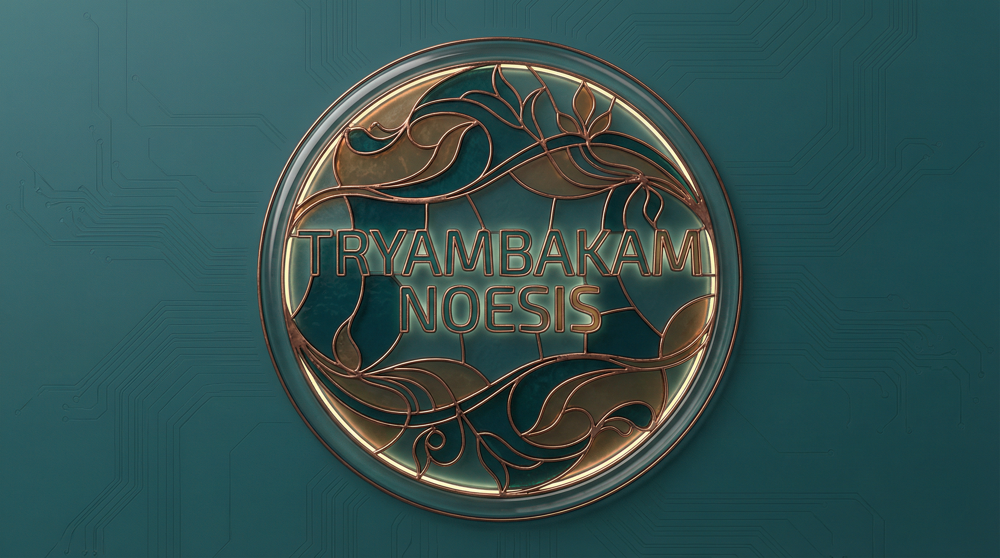

<p align="center">
  
</p>

<h1 align="center">The 17 Engines</h1>

<p align="center">
  <em>Seventeen implemented engines acting as mirrors for inquiry and synthesis.</em><br>
  <sub>17 implemented engines across Rust and TypeScript surfaces</sub>
</p>

<br>

---

<br>

# Rust Engines (11)

High-performance native calculation engines built in Rust with sub-millisecond performance.

For a body-paced narrative companion to these timing and pattern systems, see [Somatic Canticles](https://1319.tryambakam.space).

<br>

## 1. Panchanga Engine

**Vedic calendar system** — Calculates the five limbs of time: Tithi, Nakshatra, Yoga, Karana, Vara.

**Input:** `date, lat/lng, timezone`  
**Endpoint:** `POST /api/v1/engines/panchanga/calculate`

Foundation for all Vedic timing calculations.

<br>

## 2. Human Design Engine

**Complete bodygraph** — Type, Strategy, Authority, 9 Centers, 26 Gates, Profile, Definition.

**Input:** `date, time, lat/lng, timezone`  
**Endpoint:** `POST /api/v1/engines/human-design/calculate`

Synthesizes I Ching, Kabbalah, Chakras, and Astrology.

<br>

## 3. Gene Keys Engine

**64 Keys** — Shadow → Gift → Siddhi progression across 4 sequences (Activation, Venus, Pearl, Life's Work).

**Input:** `date, time, lat/lng, timezone`  
**Endpoint:** `POST /api/v1/engines/gene-keys/calculate`

Maps consciousness evolution through 64 genetic pathways.

<br>

## 4. Vimshottari Dasha Engine

**120-year timeline** — Nested planetary periods (Mahadasha → Antardasha → 729 total periods).

**Input:** `date, time, lat/lng, timezone`  
**Endpoint:** `POST /api/v1/engines/vimshottari/calculate`

Foundation for Vedic predictive timing.

<br>

## 5. Numerology Engine

**Pythagorean & Chaldean systems** — Life Path, Expression, Soul Urge, Birthday, Personality, Master Numbers.

**Input:** `date, name`  
**Endpoint:** `POST /api/v1/engines/numerology/calculate`

### Key Calculations
- Life Path Number (birth date reduction)
- Expression Number (full name)
- Soul Urge (vowels)
- Personality (consonants)
- Birthday Number
- Master Numbers (11, 22, 33)

<br>

## 6. Biorhythm Engine

**3 biological cycles** — Physical (23-day), Emotional (28-day), Intellectual (33-day).

**Input:** `date`  
**Endpoint:** `POST /api/v1/engines/biorhythm/calculate`

### Calculations
- Current phase for all 3 cycles
- Critical day detection (zero crossings)
- Peak and valley predictions
- Cycle intersection points
- Energy trend forecasting

<br>

## 7. Vedic Clock Engine

**TCM Organ Clock + Ayurvedic Doshas** — Maps 24-hour cycle to organ energy peaks and dosha dominance.

**Input:** `current_time` plus either `options.timezone_offset` or `birth_data.timezone`  
**Endpoint:** `POST /api/v1/engines/vedic-clock/calculate`

### Returns
- Current organ energy peak (12 meridians)
- Dominant dosha (Vata/Pitta/Kapha)
- Optimal activity recommendations
- Energy quality of current hour
- Resolved timezone metadata (`offset_minutes`, `source`, `local_hour`)

### Timezone Semantics
- Priority order: `options.timezone_offset` -> `birth_data.timezone` -> UTC
- `birth_data.timezone` accepts supported IANA values such as `Asia/Kolkata` and explicit offsets such as `+05:45`
- The result payload includes the resolved timezone basis so API consumers can verify which local clock the organ-hour calculation used

<br>

## 8. Biofield Engine

**Vedic Birth-Data Biofield Analysis** — Real planetary position-driven chakra readings using Navagraha dignity, aspects, and temporal transit modulation.

**Input:** `date, time, lat/lng`
**Endpoint:** `POST /api/v1/engines/biofield/calculate`

### Calculations
- 7 chakra readings via planet-chakra correspondences (Vedic Jyotish)
- Fractal dimension, entropy, coherence, symmetry metrics
- Planetary dignity (exaltation → debilitation) + aspect scoring
- Temporal modulation: Moon transit, lunar phase, day-of-week Vara
- Falls back to mock data when no birth_data provided

<br>

## 9. Face Reading Engine

**Physiognomy analysis** — Extracts facial features and maps to personality traits, health indicators, and life patterns.

**Input:** `image_data`  
**Endpoint:** `POST /api/v1/engines/face-reading/calculate`

Combines Chinese Mian Xiang with Western physiognomy traditions.

<br>

## 10. Nadabrahman Engine

**Rāga recommender** — Recommends Melakarta rāgas for the current *prahar* (3-hour watch of the day), optionally refined by Ayurvedic dosha, rasa/mood, and a target chakra's Solfeggio frequency. Rust crate `engine-nadabrahman`.

**Input:** `current_time` (prahar is derived from its hour; defaults to now) and optional `options.dosha` (`vata|pitta|kapha`), `options.rasa` or `options.mood` (one of the 9 rasas), `options.chakra` (`root … crown` or Sanskrit names)  
**Endpoint:** `POST /api/v1/engines/nadabrahman/calculate`

Returns `time_recommendation` (prahar, primary rāga, dosha dominance, energy quality), up to five scored `recommendations` with arohanam/avarohanam, and `chakra_frequency` when a chakra is given. It takes **no audio input** and performs no voice or frequency analysis, and it produces **no audio clip**. For a chosen melakarta's just-intonation data and the rendered clip, use the Raaga engine (§17). Details: [docs/engines/nadabrahman.md](engines/nadabrahman.md).

<br>

## 11. Transits Engine

**Planetary transits & Sade Sati** — Current sidereal planetary positions, natal-to-transit aspects, and Saturn's 7.5-year Sade Sati cycle detection.

**Input:** `date, time, lat/lng, timezone`
**Endpoint:** `POST /api/v1/engines/transits/calculate`

### Returns
- Current sidereal positions for 12 tracked bodies (Sun, Moon, Mercury, Venus, Mars, Jupiter, Saturn, Uranus, Neptune, Pluto, Rahu, Ketu)
- Transit-to-natal aspects (conjunction, trine, square, sextile, opposition)
- Sade Sati phase detection (rising, peak, setting)
- Retrograde status for all planets
- Witness prompts calibrated to active transits

<br>

---

<br>

# TypeScript Engines (6)

Esoteric calculation engines built in TypeScript, bridged to main Rust API.

<br>

## 12. Tarot Engine

**78-card system** — Birth cards, yearly cycles, archetypal progression through Major Arcana.

**Input:** `date, question`  
**Endpoint:** `POST /api/v1/engines/tarot/calculate`

### Calculations
- Birth card(s) from numerology
- Current year card
- Life path card sequence
- Archetypal themes
- Symbolic inquiry prompts

<br>

## 13. I Ching Engine

**64 hexagrams** — Oracle casting via yarrow stalk, coin, or digital methods. Interprets changing lines and transformations.

**Input:** `question, casting_method`  
**Endpoint:** `POST /api/v1/engines/i-ching/calculate`

Traditional Book of Changes divination system.

<br>

## 14. Enneagram Engine

**9 personality types** — Core type, wing, tritype, integration/disintegration arrows, instinctual variants.

**Input:** `date, name`  
**Endpoint:** `POST /api/v1/engines/enneagram/calculate`

### Returns
- Core type (1-9)
- Wing tendency
- Tritype combination
- Integration/disintegration paths
- Instinctual stacking (sp/sx/so)
- Centers of intelligence

<br>

## 15. Sacred Geometry Engine

**Platonic solids & geometric patterns** — Generates sacred geometry constructions, calculates proportions (phi, pi, √2), and maps to energetic resonances.

**Input:** `parameters (shape, size, proportions)`  
**Endpoint:** `POST /api/v1/engines/sacred-geometry/calculate`

Includes Flower of Life, Metatron's Cube, Sri Yantra, Golden Spiral.

<br>

## 16. Sigil Forge Engine

**Intent manifestation** — Transforms text intentions into visual sigils using letter reduction, geometric encoding, and symbolic transformation methods.

**Input:** `intent_text, method (chaos/planetary/angelic)`  
**Endpoint:** `POST /api/v1/engines/sigil-forge/calculate`

Combines Austin Osman Spare's method with planetary and angelic signatures.

<br>

## 17. Raaga Engine

**Carnatic melakarta sound therapy** — For a chosen melakarta (1–72, by number or name, or auto-selected by dosha × prahar) returns its just-intonation swaras, Strudel-compatible ratio arrays, chakra/dosha context and prahar timing. TypeScript engine (`ts-engines/src/engines/raaga`), reached through `noesis-bridge`.

**Input:** `parameters.melakarta` | `parameters.name`, optional `dosha`, `root_hz` (default 220), `include_alternates`, `request_clip` (+ granted `consent`)  
**Endpoint:** `POST /api/v1/engines/raaga/calculate`

With `request_clip: true` and granted consent the engine renders the swara ladder to a WAV clip and returns it in `generated_audio.clip_url`; delivery depends on `RAAGA_CLIP_MODE` (`off` default, `local`, `r2` hosted on Cloudflare R2, `service`). Every response carries a contract `provenance` block (`provider_id: selemene-wav-synth`, `fallback_used: true` whenever a requested clip was not delivered). Details: [docs/engines/raaga.md](engines/raaga.md).

<br>

---

<br>

# Additional Engines (In Development)

## Astrocartography Engine

**Planetary line mapping** — Projects birth chart onto world map, identifies power spots and relocation themes.

**Status:** Partially implemented  
**Input:** `date, time, birth_location`

### Calculations
- Planetary line crossings (ASC/MC/DSC/IC)
- Power spot coordinates
- Relocation chart analysis
- Travel timing recommendations

<br>

## HRV (Heart Rate Variability) Engine

**Autonomic nervous system mapping** — Predicts sympathetic/parasympathetic balance patterns and recovery windows from birth data.

**Status:** Experimental  
**Input:** `date, optional_hrv_data`

### Returns
- Baseline ANS tendency
- Optimal recovery times
- Stress resilience patterns
- Circadian HRV rhythm

<br>

## Nakshatra Engine

**27 lunar mansions** — Deep dive into Vedic lunar mansion system. Each nakshatra's deity, qualities, and karmic themes.

**Status:** Integrated with Panchanga  
**Input:** `date, lat/lng`

### Returns
- Birth nakshatra
- Pada (quarter within nakshatra)
- Ruling deity and planet
- Karmic themes
- Compatible nakshatras

<br>

## Biofield-Raaga Engine

**Sound frequency + energy field integration** — Maps birth patterns to Hindustani raaga resonance and biofield layer activations.

**Status:** In development  
**Input:** `date, time`

### Calculations
- Dominant raaga resonance
- Biofield layer activations (7 layers)
- Frequency signatures
- Time-of-day raaga cycles
- Sound healing recommendations

<br>

---

<br>

## Native Engine Provenance

Every native Rust engine's calculate envelope (and each native entry in a workflow's `engine_results`) carries the contract-v1 `provenance` block: `runtime_kind: native`, `implementation_version` = `metadata.engine_version`, `cached`, `fallback_used`, `backend_id` = `metadata.backend`, `provider_id` (only when an external provider computed the result; no native engine calls one today), `confidence` omitted. Each engine sets `metadata.fallback_used` explicitly; the API copies it, it never infers a fallback from the backend string. The envelope block is canonical. The engine-owned `result.provenance` blocks on face-reading and biofield remain for backward compatibility and always agree with it.

| Engine | `backend_id` | `fallback_used: true` when |
|---|---|---|
| panchanga | `native-rust` | Swiss Ephemeris substituted Moshier for the `.se1` files (`result.position_source: swiss_ephemeris_moshier`), or Swiss Ephemeris was unavailable and the mean-longitude approximation was used (`mean_longitude`); `swiss_ephemeris_files` is the only non-fallback source. A missing birth time is computed at local noon and reported as `result.birth_time_assumed: true` (not a fallback); an unparseable date or time is a `ValidationError` |
| vimshottari | `swiss-ephemeris-lahiri-full-v1:*` or `moon-longitude` | Swiss Ephemeris substituted Moshier because no `.se1` files were reachable (`…:moshier`); the shared resolver reads `SWISS_EPHE_PATH`, `SWISS_EPHEMERIS_PATH`, `EPHEMERIS_DIR`, then `data/ephemeris` near the cwd or executable |
| face-reading | `mediapipe-face-cv`, `heuristic-image-landmark-hook`, `birth-physiognomy-fallback`, `mock-stub` | anything but real CV landmarks: no image (birth-data physiognomy or mock), no consent, sidecar disabled/erroring/deterministic |
| biofield | `vedic-ephemeris` or `mock` | the mock and capture-mock paths (no birth data); never on the vedic path |
| biofield-capture | `persisted-reading` | never: a missing or foreign reading is an error, not a silent mock |
| vedic-clock | `native` | never (local organ clock; does not call the vedic provider) |
| transits | `swiss-ephemeris` | Swiss Ephemeris substituted Moshier for the `.se1` files |
| human-design | `swiss-ephemeris` | Swiss Ephemeris substituted Moshier for the `.se1` files |
| gene-keys | `hd-derived` or `hd-gates` | birth-data mode only: the Human Design chart it derives from used Moshier |
| numerology | `native-rust` | never |
| biorhythm | `native-rust` | never |
| nadabrahman | `native` | never |
| financial-biosensor | `composed-native-rust` | never (absent contributors lower `coverage`; they are not a fallback) |

Swiss Ephemeris keeps its state per thread on Linux, so every calculation runs under `engine_human_design::lock_ephemeris()`, which applies the resolved ephemeris path to each thread on first use; Moshier substitution is read from the flags each calculation returns. Biofield's vedic path uses the same ephemeris but does not yet report Moshier.

Bridge (TypeScript) engines keep the block their sidecar emits; a malformed sidecar block is dropped, not replaced. Input defaulting (an unknown timezone resolved to UTC, a missing birth time treated as noon) is not reported as a fallback.

<br>

## Common Response Format

All engines return this unified structure:

```json
{
  "engine": "engine_name",
  "result": { /* engine-specific data */ },
  "witness_prompt": "Calibrated question for self-inquiry",
  "consciousness_level": 0,
  "metadata": {
    "calculation_time_ms": 0.042,
    "backend": "native",
    "version": "3.0.0"
  }
}
```

<br>

---

## Rich Witness Dyad and Premium Assets

Selemene is the canonical service for rich Aletheios + Pichet voice interpretation and premium integrated reading / asset generation.

- Every engine returns a lightweight `witness_prompt` — this is the rule-based, non-prescriptive mirror entry point and remains unchanged.
- Rich dyad interpretation (Aletheios voice, Pichet voice, synthesis) is served from Selemene via `/api/v1/witness/interpret` (and SDK `interpretWitness`).
- Multi-pass premium assets are available via additive surfaces (e.g. `POST /api/v1/assets/generate`, SDK `generatePremiumAsset`).

**Retirement note:** witness-agents is now reference + asset source only (personas, mode documents, historical batches). All live rich dyad and premium asset traffic uses Selemene endpoints and the existing SDK surface. The non-prescriptive "mirror" philosophy is preserved.

---

<br>

<p align="center">
  <a href="../README.md">← Back to Main README</a>
  &nbsp;&nbsp;|&nbsp;&nbsp;
  <a href="api/README.md">API Documentation →</a>
</p>

<br>
