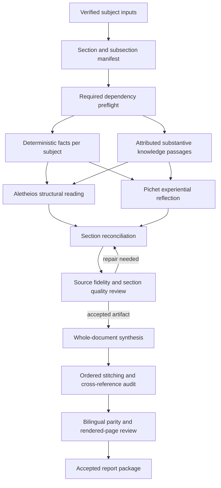

# Witness report contract repair

Status: real Cloudflare retrieval and authoritative persona execution connected; full report and rendered/bilingual acceptance still pending.
Date: 2026-09-30

## Intended result

Produce detailed integrated readings section by section, with the existing Witness architecture participating in generation and review, then assemble an internally consistent document. The previous eight reports are not accepted as reference-equivalent deliverables merely because their twelve passes and narrow checks passed.

## Verified evidence

- The supplied DOCX has 352 paragraphs and 12 tables. Its hierarchy is Opening plus Parts I–XI, with detailed subsections listed below.
- The supplied PDF has 43 pages. Its text includes the same thematic parts, cross-reference tables, figures and an anti-dependency practices chapter. Text extraction verifies content and hierarchy, not visual rendering quality.
- `../witness-agents/scripts/integratedreading/stitcher.ts` explicitly says it mirrors the source DOCX: Opening + Parts I–XI. Its ordered keys are opening, part1 ... part11. This existing contract must be evaluated before inventing another report skeleton. Its filtering of missing chunks is not sufficient as a completeness gate.
- Both new `packages/witness-pipeline/modes/*-12.md` modes declare `architecture: linear`. Their section plans do not reproduce the reference chapter contract.
- `packages/witness-pipeline/src/orchestrator/integrated.ts` runs a single section-writing LLM interface followed by optional Jev judgment; this inspected path does not invoke the Aletheios/Pichet dyad. It appends section strings to assemble the document. Prior prose is limited to the last 4,000 characters and is injected only through a template placeholder; the new mode templates do not request that placeholder.
- `packages/witness-pipeline/scripts/mode-matrix-runner.ts` constructs the orchestrator without a retriever or retrieval query. Optional retrieval support elsewhere does not demonstrate retrieval in this route.
- Mode and system instructions prohibit explaining several symbolic labels unless authorized meanings are supplied. No knowledge retrieval is connected here to supply that missing interpretive material. Increasing token budgets cannot fix that contract conflict.
- `src/orchestrator/rubric.ts` counts system vocabulary as `deterministic_fact_count`; those counts are not claim-to-source verification. Layer checks are primarily English regexes, so they are not a sound bilingual depth gate.
- `src/orchestrator/final-verification.ts` blocks placeholder failures, chart-fidelity failures and active Jev blocks; it does not require depth, layer, word-fit or witness-execution success. The inspected rubric emits a fidelity score, not the chart_fidelity_gate that final verification reads.
- The saved matrix reports PASS for all eight outputs while word-fit passes range from 1/12 to 4/12. This does not prove the prose is poor by itself, but proves PASS does not mean all advertised rubric dimensions passed.
- Witness Agents is retired as a live service. Its RETIREMENT.md identifies Selemene as the canonical runtime and the sibling repository as authoritative persona, mode and historical implementation reference. Do not restart the retired service to repair this pipeline.

## Architecture to reconcile

User confirmed both layers on 2026-09-30: the witness pair plus grounding infrastructure. Both are required; they retain separate evidence and acceptance checks:

1. Witness dyad: Aletheios provides structural interpretation; Pichet provides experiential reflection; a synthesis stage reconciles their outputs. Preserve persona and anti-dependency contracts. Neither voice can turn symbolic labels into physiological findings.
2. Grounding infrastructure: deterministic engine facts plus source-attributed interpretive knowledge. Inspect the existing witness-wisdom-corpus and its retrieval implementation independently of Selemene pattern-memory. An absent pattern-memory Worker is not evidence that the historical wisdom corpus is absent. Cortex is a separate integration and must not substitute silently for either.

No live availability or provider credential claim is established by this local audit.

## Proposed section contract

Every required subsection has a stable ID, explicit subject scope, evidence dependencies, authorized knowledge references, purpose, and content requirements. A subsection must contain substantive explanation where sources support it. Missing evidence is a visible coverage gap, not a reason to silently omit a chapter or fill it from the legacy example.

For each section, save: input hashes and source IDs; Aletheios output; Pichet output; reconciled draft; claim-to-source map; rubric and Jev receipts; revision history; accepted text hash. Distinguish calculated fact, attributed framework meaning, tentative synthesis and user-reported experience.

The section-writing sequence is:

1. Inventory actual data per subject, including calculation timestamps and uncertain birth inputs.
2. Build the reference-derived section manifest and mark available/blocked dependencies.
3. Retrieve authorized framework material per section with passage IDs and retrieval receipts.
4. Generate the structural and experiential witness contributions using the canonical runtime contract.
5. Reconcile into one readable section with exact factual attribution and meaningful subsections.
6. Evaluate factual accuracy, subsection coverage, explanatory substance, distinct witness contributions, contradictions, language, repetition and anti-dependency. Repair failed sections locally.
7. Generate convergence and final synthesis from all accepted section artifacts, not a tail of prior prose.
8. Stitch accepted sections in manifest order. Resolve cross-references, repeated tables and terminology; audit the final assembled text after any editorial edits.
9. Produce English and French from the same accepted source contract. Check subject attribution, values, section parity and meaning in both languages.
10. Render DOCX/PDF and inspect pages, tables, chart attribution, navigation and page breaks. Packaging is a separate acceptance dimension.

## Reference-aligned content map

| Part | Content obligation |
|---|---|
| Opening | Scope, source key, systems actually available, reading conventions |
| I | Identity stack, supported thematic convergence, meaningful differences |
| II | Detailed Vedic foundation, exact placement/house tables where available, attributed explanation |
| III | Symbolic pattern architecture and dated historical period context |
| IV | Work and dharma, integrating sourced framework interpretations without assigning real-world capability |
| V | Resources and money as reflective themes, distinct from financial advice or forecasts |
| VI | Relationship themes appropriate to the declared relationship mode |
| VII | Energy and lived experience, grounded in supplied data or optional self-observation rather than invented anatomy |
| VIII | Family, roots and lineage as attributed framework reflection |
| IX | Fully sourced timing map with explicit snapshot dates and uncertainty |
| X | Optional practices and anti-dependency: capacity for independent reflection |
| XI | Whole-document synthesis, tensions, limits and a coherent closing |

For the business triad, adapt relationship and family content to the declared business scope rather than copying romantic/family predictions. Preserve individual, pairwise and three-person attribution. The reference is a depth and structure contract, not a source of the three subjects' facts.

## Acceptance before regeneration is called complete

- Every required section/subsection is present or visibly blocked with its missing evidence named.
- Canonical runtime path and actual provider/model are recorded; no infrastructure component is credited merely for being configured.
- Both witness contributions and their reconciliation are inspectable per section.
- Every factual claim resolves to subject-specific evidence; framework explanations resolve to approved knowledge passages.
- Retrieval success, empty result, failure and disabled state are distinct; no silent success when retrieval fails.
- Rubric dimensions required by the selected mode are enforced by final verification, including unknown/missing required gates.
- Ambiguous Jev judgments have an explicit disposition; they are not relabeled passed.
- Synthesis consumes all accepted section artifacts and adds no unsupported facts.
- Section hashes and final artifact hashes match the actually reviewed versions.
- French and English retain the same facts and coverage; judges and deterministic checks support both languages.
- A single complete pilot reading demonstrates depth and rendering before repeating generation for all eight outputs.

## Implementation order

First reconcile the existing architecture and data coverage, then restore the section manifest and truthful quality gates. Connect the canonical dyad and knowledge layer using existing interfaces. Run synthetic failure tests for missing sections, missing witness receipts, unavailable retrieval, cross-subject fact contamination and post-review edits. Generate one pilot, inspect its content and rendered pages, then generate the remaining bilingual set. Preserve pre-existing dirty changes and old reports as evidence throughout.

## Exact DOCX heading inventory

These titles are documentary evidence of the supplied reference, not endorsed claims or confirmed personal facts.

- Opening — Why Five Systems
- Part I — The Convergence Map
- 1.1 The Identity Stack
- 1.2 What All Five Agree On — The Bedrock
- 1.3 What the Systems Disagree On — The Texture
- Part II — The Vedic Foundation
- 2.1 Lagna — Vrischika (Scorpio) at 12°14', Anuradha Pada 3
- 2.2 Moon — Kanya (Virgo) at 9°49', Uttara Phalguni Pada 4
- 2.3 Sun — Karka (Cancer) 26°21', Ashlesha Pada 3
- 2.4 Planetary Placement Table
- 2.5 House Distribution — The Top-Heavy Chart
- 2.6 The Saraswati Yoga — Why You Can Articulate
- 2.7 Yogas, Doshas, Strengths
- 2.8 Functional Benefics & Malefics for Vrischika Lagna
- 2.9 Atmakaraka Jupiter — The Soul's Headline
- 2.10 The Cosmic Signature — One Sentence
- Part III — The Karmic Architecture (Past → Present)
- 3.1 The Rahu-Ketu Axis
- 3.2 The 8th House Inheritance
- 3.3 The 12th House Pluto
- 3.4 The Lived Mahadasha Trail (Childhood, Teen, Twenties)
- 3.5 Karmic Patterns Likely Repeating Until Transmuted
- Part IV — Career & Dharma (Quadruple Convergence)
- 4.1 The 10th House Stellium — Three Planets, One Drumbeat
- 4.2 The 5th-10th-Lord Raj Yoga
- 4.3 Career Path — Best-Fit and No-Fit
- 4.4 Career Timeline by Mahadasha
- 4.5 Foreign Settlement / Travel
- 4.6 Fame and Public Recognition
- Part V — Wealth & Money
- 5.1 The 2nd House — Rahu in Sagittarius
- 5.2 The 11th House — Moon in Virgo
- 5.3 Property & Real Estate
- 5.4 Inheritance & Sudden Gains
- 5.5 Best Earning Periods (Lifetime Map)
- 5.6 Debt & Caution
- Part VI — Love, Marriage, Spouse
- 6.1 The 7th House and Its Lord
- 6.2 Darakaraka — Rahu in Sagittarius (Purva Shadha)
- 6.3 Love Marriage vs Arranged
- 6.4 Marriage Timing Indicators
- 6.5 Marriage Quality, Stability, Friction
- 6.6 Divorce / Separation Indicators
- 6.7 The Spouse Profile (Synthesised)
- Part VII — Health & Energy Body
- 7.1 Constitution
- 7.2 Specific Health Indicators
- 7.3 Mental & Emotional Health
- 7.4 Health-Sensitive Age Periods
- 7.5 Preventive Programme Aligned to Chart
- Part VIII — Family, Roots, and Soul Lineage
- 8.1 Mother (Moon, 4th house)
- 8.2 Father (Sun, 9th house, 10th lord)
- 8.3 Siblings (3rd house)
- 8.4 Children (5th house)
- 8.5 Family Karma & Inherited Patterns
- 8.6 Spiritual Growth
- Part IX — The Master Timeline
- 9.1 Where You Stand Right Now (May 2026)
- 9.2 The Defining Pivot — 14 September 2026, 5:48 AM
- 9.3 Jupiter Mahadasha Antardasha Map (16 Years)
- 9.4 The Sade Sati Overlay (2027 - 2034)
- 9.5 Year-by-Year Forecast
- 2026 — The Pivot Year
- 2027 — The Restructuring Year
- 2028 — Consolidation
- 2029-2030 — Apex Pressure & Apex Reward
- 2031-2034 — Saraswati Peak & Sade Sati Closing
- 2034-2042 — The Outer Ring of Jupiter MD
- 2042+ — Saturn MD
- 9.6 The Master Cross-Reference Table
- Part X — Remedies (Multi-System)
- 10.1 Vedic Remedies (specific to your chart)
- Strengthen Atmakaraka Jupiter (most important)
- Strengthen Sun (10th lord, Atmakaraka companion)
- Pacify Rahu (closing Mahadasha — needs clean exit)
- Pacify Saturn (preparing for Sade Sati from 2027)
- Honour Ketu (8th house mystic inheritance)
- 10.2 Numerology Coordinates
- 10.3 HD-Aligned Practices
- 10.4 Gene Keys Annual Contemplation
- 10.5 Practical Life Corrections
- Part XI — Final Synthesis
- 11.1 The Single Sentence
- 11.2 The Biggest Life Lesson
- 11.3 What to Avoid
- 11.4 What to Strongly Pursue
- 11.5 Destiny Strengths
- 11.6 Core Karmic Purpose
- 11.7 Honest Final Prediction (no sugarcoating)
- 11.8 The One Practice That Ties All Five Systems Together
- 11.9 Closing

## Live infrastructure findings after user confirmation

- Both witness dyad and grounding infrastructure are explicitly required by the user.
- Read-only Vectorize list and info succeeded with account `9d9d23b27f32e70ae3afb6a1aa2c0f10`: witness-wisdom-corpus exists, 1024 dimensions, 837 vectors. Default account selection first failed authentication. No persistent account configuration was changed.
- Generic framework-only query through the historical NVIDIA embedding adapter failed with HTTP 410: baai/bge-m3 reached end of life on 2026-08-25T09:00:00Z. No subject data was sent. Do not replace the model with a merely dimension-compatible embedding: its vector space must match, or a separately authorized corpus migration is needed.
- Corpus population is verified; successful semantic retrieval is not. The former absent-pattern-memory claim does not establish absence of this knowledge corpus.
- Current Gary engine bundle has Human Design, Panchanga, Vimshottari, numerology, Gene Keys and HumDes reference only. Full Vedic placement/house inputs are not present in that bundle.
- Workflow console on localhost:5173 refused the browser connection; no service was started.

- Direct Vectorize get-vectors lookup succeeded for `sw:hd:type:generator:desc` and `sw:hd:g:34:desc`. This proves content retrieval by stable ID, not semantic-search recovery. The Gate 34 text is generic (“representing specific life themes and energy patterns”), so nonempty passages need a substantive-content gate before grounding detailed interpretations.

- Local corpus seed `data/human-design/gates.json` has 58 generic descriptions containing “specific life themes and energy patterns” among 65 description fields (including metadata). The live Gate 34 lookup exhibits the same generic wording. This is a content-quality blocker distinct from retrieval availability.

## Candidate review correction

The first routed implementation was interrupted after review found that it allowed disabled retrieval and omitted required-field failures. A corrective bounded dispatch was issued. No completed implementation or provider-attributed report generation is claimed. Its routing receipt named the selected seat `cc/claude-sonnet-4-6` but returned unresolved execution attribution after cancellation.

The reference hierarchy must be generalized for each subject: for example, a Jupiter-specific antardasha heading in the legacy example becomes the actual supplied Mahadasha heading. Legacy example headings must not smuggle chart facts into another subject's report.

## Required execution flow

The current linear route does not demonstrate this full flow. The new local scaffold is not live acceptance until the required adapters, substantive passages and real pilot have receipts.

## Local validation receipt

- TypeScript no-emit check passed after review corrections.
- Focused orchestrator and retrieval suite: 12 test files, 71 tests passed. These are local/synthetic checks, not live dyad or report acceptance.
- Reference mode parser returned opening, part1 through part11, policy descriptive.
- CLI command `node packages/witness-pipeline/node_modules/tsx/dist/cli.mjs tools/humdes-extractor/run-integrated-report.mts --reference-preflight` exits 1 with dyad:not_configured and grounding:unconfigured. This path executes before filesystem writes. Environment declarations cannot make the absent CLI adapters pass.
- Review corrected empty-retrieval acceptance, gate opt-outs, missing rubric fields, duplicate result IDs, and stale synthesis input hashes.
- The new dyad helper is a local draft wrapper, not verified canonical Selemene execution. Subsection-level coverage, substantive passage checks, canonical adapters, full pilot generation and rendered review remain unfinished.
- Original report route remains available for compatibility; its old PASS is not acceptance against the new reference contract.
- No report regeneration, deployment, push, corpus migration or remote data mutation was performed.

## Implementation evidence on 2026-09-30

- Live exact-ID retrieval works through the installed Wrangler CLI, with account isolated to the child process and service batches of at most 20 IDs. Shesh preflight returned 31 usable passages from 35 requests; Gary returned 59 from 63. Blank/generic passages and private historical subject entries are rejected. Stored-vector semantic query was separately verified and saved in `reports-reference/semantic-retrieval-proof.json`.
- The reference orchestrator invokes both authoritative identity texts independently and reconciles both full responses with every prior section. It saves raw outputs, full synthesis input, persona/source/output hashes, retrieval receipts, repairs, and Jev judgments. Missing dyad, failed retrieval, missing subsections, and unresolved final gates cannot produce accepted output.
- The report LLM adapter now uses streaming OmniRoute calls, records the requested combo and returned model, excludes reasoning deltas, and requires clean completion. A non-streaming attempt failed with a gateway 30-second first-response timeout; that failed run is preserved.
- Jev reference requests carry full engine context, the entire generated section, and retrieved framework passages. The legacy limits of 6,000 fact characters and 12,000 section characters remain only for legacy requests.
- The DOCX reference was rendered read-only with bundled LibreOffice to 41 pages. This differs from the separately supplied 43-page legacy PDF; neither count is imposed as the new report page target. Only the reference cover has been visually inspected so far.
- Report candidates remain unaccepted while content, complete-manifest and rendered checks are in progress. Existing eight reports remain intact.

## Pilot checkpoint — 2026-09-30, distinct witness contributions

The run `sheshnarayan-en-2026-09-30T00-01-36-854Z` retrieved 31 usable CF passages and executed both authoritative personas through OmniRoute, resolving to `claude-sonnet-4-6`. Its opening completed with separate 564-word structural and 597-word experiential contributions. The opening Jev guardrail score was 0.83 (`could-not-tell`), which remains unresolved; a separate sentence diagnostic found no flagged sentences among the bounded first 40 eligible sentences and does not override that judgment.

Part I failed the enforced word-fit gate after repair (1,505 whitespace-separated words against a 1,200 target). Both witness contributions also exceeded their requested bounds. The failed receipt remains intact. Subsequent prompt repair isolates the composer brief as reference material for the witnesses and makes length repair an editorial operation on the draft, preserving source attribution and required headings. The focused execution suite still passes 33 tests. No full pilot or final bilingual acceptance is claimed.

### Word-fit correction and restart integrity

The whitespace-token counter incorrectly charged Markdown-only table pipes, heading markers, and punctuation as words. The two failing outputs above contain 683 and 1,419 textual/numeric tokens respectively, inside the unchanged 80–120% limits. The shared rubric and execution counter now exclude formatting-only tokens while preserving accented text, numerical values, and source labels. Historical receipts are not rewritten or retroactively accepted.

The runner now supports `--resume-from RUN_DIR`, validates the immutable prefix against input/persona/runtime hashes and freshly retrieved source text, and retains original Jev ambiguity. Malformed JSON and changed source text reject reuse. A runner integration regression discovered during review (passing mode text to a path parser and losing the preflight exit) was repaired before the next full pilot. TypeScript checking and 233 tests across 20 focused files pass. The full pilot is still required before final acceptance.

### Claim audit falsification and correction

The first standalone audit on the preserved Part II draft, using `noesis-execute` (returned `claude-sonnet-4-6`), returned clean with a count of 61 and no findings despite known errors. That response is preserved in `part2.source-audit-live.json` and is not accepted as adequate review. The separate `noesis-verify` rail (returned `gemini-3.7-flash-tiered`) found the erroneous highest-degree comparison and required a correction. This is evidence of improved detection for that case, not proof that every source mismatch was detected.

The parser now requires inspectable exact claim quotations and supporting source references/values for a clean audit. It derives the count from those entries, rejects missing/nonmatching evidence, and final verifiers reparse the raw audit response and bind it to the reviewed output, engine-facts text, and retrieved passages. Source audit remains model review and is kept distinct from deterministic integrity checks and Jev. The actual runner requires the separate review rail.

An additional bounded length-only edit preserves the initial failed repair and final checks; it never widens limits. Regression tests retain the false-clean response as a failing case. The focused suite passes 276 tests across 21 files, and TypeScript checking passes. A new full pilot is running at `sheshnarayan-en-2026-09-30T00-47-39-218Z`; final report acceptance is still pending.

- 2026-09-30 01:00 UTC continuation: pilot `00-50-49-498Z` terminated at Part I synthesis timeout after both witness outputs; session 5283 is terminal, not active. Opening remains editorially unaccepted (six numerology fields, empty Enneagram scope, and prompt-only citation findings).
- Live corpus review found identical category boilerplate for Gene Keys23/43/49. Exact observed boilerplate is now excluded by the adapter; new live preflight `01-00-22-375Z` returned19 usable/35requested (previous31 included12generic passages). No CF corpus was mutated. Adapter20tests and engine-facts4tests pass. Compact numerology now includes supplied Chaldean value; mode instructs explicit scope/count/citation distinctions. Full report and bilingual acceptance remain open.

- 2026-09-30 01:04 UTC checkpoint: bounded transient synthesis retry implemented, preserving first error and both existing witness contributions; arbitrary errors and deliberate cancellation are not retried. Parent tightened HTTP message detection to exclude unrelated numbers. 162 tests across execution, resume, both final verifiers and CF adapter passed; TypeScript and diff whitespace checks clean. New full pilot `reports-reference/runs/sheshnarayan-en-2026-09-30T01-04-32-223Z` is active in session23489, with19/35usable CF passages. Earlier session14034 builder is terminal; wrapper model attribution unresolved, so its actual provider is not certified. No final report accepted.

- 2026-09-30 continuation: new opening `01-04-32-223Z` has an explicit source-review correction despite model audit clean: it contradictorily calls transit natal coordinates tropical. Current `crates/engine-transits/src/ephemeris.rs`42/75 converts to Lahiri sidereal. Review saved to opening.editorial-review.json. The live run continues; do not treat clean model audits as final factual acceptance. Runner finalAccepted now staysfalse while editorial/render/parity review is pending (current running process predates this runner-only fix).

- 2026-09-30 01:13 UTC checkpoint: session23489 is terminal. Pilot `01-04-32-223Z` completed opening, then failed PartI source audit: the 30-entry clean ledger includes a paraphrased quoted claim (`panchanga (~159.83°, vedic-kundali ~159.806°)`) absent from the chapter. Both voices and synthesis are saved; no transport timeout this run. Next repair should recover the audit response against the saved draft, not restart full generation.
- New immutable editorial-revision primitive and24passing tests; parent fixed missing receipt hash acceptance and overlapping occurrence detection. Live opening correction stored in opening.editorial-revision.json and opening.editorial-candidate.md, original untouched; base1c59c75b..., revision0ba9725c..., all sourceAudit/Jev/document/coherence reviews pending. `tools/humdes-extractor/apply-opening-editorial.mts` is a source-specific reproduction harness for this reviewed correction. No final report accepted. Worker25219 terminal; no live generation process remains.

- 2026-09-30 01:24 UTC: audit-only response recovery implemented with at most one extra model response for malformed/insufficient output, preserving raw failed response, validation reason and recovery prompt. No retry of caller passage-hash mismatch, no prose/voice reruns. 167 tests across audit/execution/two verifiers/editorial-revision passed; TypeScript and diff checks clean. Worker25047 terminal (wrapper attribution unresolved).
- Saved PartI audit-only recovery succeeded (38checks), but manual source review found numerical count, dates, unsupported interpretation/provenance and ordinal-citation defects. They are fixed through immutable patches. Latest candidate is part1.editorial-candidate-v3.md / editorial-revision-v3.json, hash d98feb48a0fd50a6b5238c1d1e8e2ee0483b12fb3f3df8730bc3e5783b7406ce,1435words. Prior revisions preserved. Opening corrected candidate589words has fresh clean25check audit at01-23-18.
- Fresh Jev reviews of both revised candidates remain guardrail could-not-tell, allother dimensionspass. The mode requires an explicit disposition of ambiguity; current strict finalverifiers only allowallpass, so a transparent hash-bound resolution workflow is still needed, never relabeling the originalverdict. Editorial revisions also need a provenance-aware continuation path: preserve raw synthesis/witness receipts and pass revised prior context to subsequentchapters without claiming model reruns. Avoid restarting opening/PartI unnecessarily. No complete report, rendering or bilingualacceptance.

- Final checkpoint01:25UTC: latest PartI v3 fresh source audit succeeded with55quotedclaimchecks (`part1.audit-recovery-2026-09-30T01-24-51.346Z.json`). Prior empty/truncated response is retained separately. Session85464 terminal; no live processes from this turn remain. Both latest editorial candidates now have fresh source audits, but Jev guardrail dispositions, coherent continuation, full generation, render and bilingual review remain pending.

- 2026-09-30 01:42 UTC: full nonblank-line Jev diagnostics covered opening6units and PartI41units, complete withno flags at existing0.5 threshold. Direct assistant review dispositions saved for exact revised hashes; original could-not-tell remains. New guardrail-disposition validator hardened by parent: requires judged/unblocked and otherdimensionspass, exact policy questions, per-batch statehash, parsed object equality with hashed raw evidence, and finalAcceptedfalse. 48tests pass; real opening/PartI dispositions validate and sidecars saved. This leaf validator is NOT yet integrated into final report acceptance.
- Editorial prefix loader + runner --editorial-prefix implemented. Recomputes edits from original receipt, checks input/persona/freshCF/source/audit/Jev hashes and contiguous prefix, preservesrawsynthesis/output_hash/outcome unchanged, passes revised text separately. Supports explicitly supplied current implementation code only after exactbyte/hash/scope verification. Latest96tests (prefix21, disposition48,resume27) pass; TypeScript and diffchecks clean. Worker71479 and9175 terminal; wrappermodelattribution unresolved.
- Original audit wrappers used canonicalJSON base hash; new opening.audit-raw-bound.json and part1.audit-raw-bound.json bindexactreceiptfilebytes andlinkpreservedoldwrappers. Modelresponses/inputhashesunchanged. Manifest editorial-prefix.manifest.json now references raw-bound wrappers.
- ACTIVE LIVE PROCESS session34695, newrun `reports-reference/runs/sheshnarayan-en-2026-09-30T01-41-24-265Z`, command run-reference-report.mts --combo noesis-build --editorial-prefix priorrun/editorial-prefix.manifest.json. FreshCF19/35, openingandPartIreused, PartIIbothvoicescompletedwithactualreturnedmodelclaude-opus-4-7; synthesisunderway. Poll thishandlebeforeanyrestart. ReusedPartIlogoutcome=failed is ORIGINAL preservedauditfailure, notcurrentgenerationtermination. No fullfinalacceptance yet.
- Remaining finalacceptance work: provenance-aware verifier must validate originalrawgeneration hashes separately from effective editorial output/review hashes, preserve generation-time prior-version edges (PartI used originalopening) and require whole-documentcoherence onfinaleditedtext. Current strict verifier intentionally blocks editorial mismatches; do not rewrite rawreceipts or silently relabel Jev. Fullpilot/render/bilingual/triad stillpending.

- 2026-09-30 02:00 UTC continuation: active pilot session34695 completed PartII, PartIII and PartIV; now PartV generation. Raw receipts retain original19CFpassages. Manual source reviews are changes-required: PartII4, PartIII4, PartIV10 findings. Source-audit prompt now explicitly checks conditional symbolic claims, mixed lordship graphs, plural predicates and UTC scope; 28audit tests pass, but fresh PartIII model re-audit still returned clean25checks despite manual findings. This is a demonstrated semantic audit limitation, not acceptance.
- Runner now additionally requests each saved planetary nakshatra_num as an exact CF ID (integers1–27 only). Read-only preflight `01-56-59-965Z` verified25usable/41requested, adding nakshatras9,11,10,21,20,7; no corpuswrites and no retroactive changes to currentgeneration. TypeScript and diffcheck passed after the runner/audit changes.
- Primary house-meaning supplement remains separately attributed, not ingested or runtime-connected. Existing Vedic face-reading palaces file is not a Vedic-bhava source. Routed verifier worker session38567 remains active; preliminary review identified raw receipt byte binding, required Jev dimension completeness, historical revised prior-context handling and coherence validation gaps. See `2026-09-30-editorial-verifier-review.md` before accepting or integrating its output. No complete report or bilingual/render acceptance yet.

- 2026-09-30 02:05 UTC: first verifier worker38567 terminal, reported161focusedtests. Parent review found acceptance holes, so output remains unaccepted; followup scoped worker35718 is live, fixing reviewitems1–5 only. No final-verification/runner integration yet.
- PartII revised through12exactsource-referenced patches;1639words, hash37a23575f01ec3046d6e3a5665c271b60195049e48e93cc07e93a2153b6ec07f. Freshsourceaudit02-03-23clean38checks andfreshJev02-03-05allfourpass. Originalmodelreceiptsunchanged. PartIII revisedthrough11patches,1436words,hash26b0fd4d7a684124ae98268830e33f358a8c34f00e656180b42860fb5a14738c;freshJev02-04-53allfourpass,sourceauditinsession64985pending. Whole-documentcoherence/render/paritystillopen.

- 2026-09-30 02:12 UTC: PartIII freshsourceaudit02-05-27clean38checks. PartIVlatestv2 has21patches,1447words,hash547b9eb1304cc2085db3596790969b9b9a58351f8aff0911876777090e9176a7;freshsourceaudit02-08-00clean55checksandJev02-07-44allfourpass. Allwhole-documentreviewsremainpending.
- Fullpilot34695 TERMINAL: PartV bothvoices saved, synthesis timedouttwice (synthesis_transient_retry then synthesis_error), no synthesisoutput. Neverrestartopening/PartsI–IV. Worker9498 ACTIVE ownsboundedvoice-reuse synthesisrecovery in reference-execution + tests + newrecover-reference-synthesisCLI; no liveexecutionauthorizedinsideworker. Worker35718 stillACTIVE ownsverifierhardening. Actual prior_section_content_hashes are chapterTITLES, notsectionIDs; validate realreceiptsbeforeacceptingverifierfixtures.
- Partialopening–PartIVDOCX/PDF rendered: initial19pages, sampledvisualreviewpages2/5/10/14 foundreadableplanet/timelinetables,densesysteminventory. Renderer nowstartsEnglish/Frenchmajorchaptersonfreshpages; preview-v2is21pages,chapterstarts5/10/14/18verifiedbyPDFtext. Preview is explicitlypartial and finalAcceptedfalse. Copyedit/TOCopening/denseinventoryfindings savedinpartial-render-preview/layout-review.json. PDF openedintheapp. No fullreportor bilingualacceptance.

- 2026-09-30 02:26 UTC checkpoint: verifier worker35718 terminal. Parent strengthened whole parsed receipt equality (worker checked fourfields only), rejected emptyraw priorcontext/null declarededges, and supported real title-keyed hashes of `## Title\n\noutput`. Added5tests; 101reference/editorialtests passed. Real PartsII–IV historical-context check haszero blockers; receipt historical-context-verification.json saved. TypeScript passed after fixing duplicateimport/testtyping.
- Five-section correctedprefix (opening–PartIV) nowhasmanifest editorial-prefix-through-part4.manifest.json and localvalidationreceipt valid=true againstsaved25passageCFreadback. Opening/PartIguardrailambiguitiesremain disclosed; finalfalse. FreshCFreadback stillrequiredonnextgeneration.
- Source-supplement leaf worker14315 terminal. Parent tightened independentlyselected CFtarget, whitespaceblank rejection, primaryURLvalidation, fullrecordequality/extrakeyrejection and privatebaseIDrejection. Latest130tests pass across passage29/editorial53/reference48. Twelvehouseprimarysummaries fromRao2000total137words savedas house-meaning-source-supplement-v2.json, separatelyattributed/nonclinical/nonpredictive, notCFingested. Preparedactualmixed37passages (19base+6CF+12primary),hash442a5089be597bbdc384ab61ef24b13397cff14390acd98cd20abfa5dcc4afd3, notrouteconnected.
- ACTIVE workers:9498 synthesisrecovery;72443 final-verifierintegration + posthocCLI;93031 optionalreviewedpassageintegration (editorial-verifier/prefix/reviewCLI only). Worker9498 currentCLI is prepare-only and splitspreviouschapters on generic horizontalrules; inspect/fix before liveuse because actualpriorchapterscontain internal horizontalrules. Its input systemprompt reconstruction must also match integrated.ts systemprompt, not templatebody. No livegenerationcurrentlyrunning; pilot34695 remainsterminalPartVtimeout.

### 2026-09-30 02:46 UTC — supplemented editorial route and acceptance review

- Confirmed real component verification for corrected Opening–Part IV: full Jev artifact binding fixed rather than projecting only verdict fields; historical prior-context checks remain bound to the exact chapter wrappers consumed during generation.
- Added `execute-saved-synthesis.mts` and launched Part V synthesis-only recovery against 19 freshly re-read CF passages, five exact historical chapter hashes, original mode/builder code hashes and saved witness outputs. The recovery refuses witness regeneration. Run `recovered/part5-2026-09-30T02-31-28-286Z` is still processing; it is not an accepted chapter/report.
- Fresh CF readback at 02:41 returned 25 passages and matched every original source hash. Separate `editorial-source-registry-2026-09-30T02-41-20-112Z.json` records six additional CF passages plus twelve short attributed primary-document passages. Primary passages have not been inserted into Vectorize.
- Forwarded trusted passage registry and expected CF identity through reference verification and the runner's optional editorial-prefix registry route. The review CLI now re-reads original and additional CF passages before running a supplemented audit; saved corpus files alone are not presented as fresh readback.
- Hardened supplemented evidence against null/malformed arrays and repaired the complete Jev test fixture type without weakening comparison. Reference/editorial/prefix focused tests passed 137 checks before three new malformed-evidence cases; the updated editorial file passed all 64 tests. Package typecheck passed after the fixture repair; CLI review typecheck passed. Runner typecheck is pending the active process.
- Part II v2 restores explicitly attributed ninth/eleventh-house interpretation and fixes the lowercase sentence. Its source audit is running with the actual mixed passage set; Jev and document/coherence reviews remain pending. Previous reviewed Part II remains available.
- Review of the new final-verification CLI caught invented all-pass rubric defaults and packaging checks that only validated arbitrary receipt bytes. A bounded repair is running for canonical full-section contracts, real rubric evidence, artifact-bound render/parity/coherence checks and adversarial tests. The finished worker's earlier test claim is not final acceptance.
- Full twelve-section pilot, complete document review, French parity and eight-deliverable acceptance remain incomplete. Original reports and original receipts are preserved.

### 2026-09-30 02:55 UTC — real supplemented chapter verification

- Part II v2's first supplemented audit returned `llm-error` (empty/truncated response); receipt retained. One retry returned clean with 53 checks at `part2.audit-recovery-2026-09-30T02-46-32.768Z.json`. Fresh Jev at `02-47-19.210Z` passed all four dimensions. Real `verifyEditorialSection` against independent registry and original bytes returned zero blockers; see `part2.supplemented-editorial-verification.json`.
- Added optional passage registry support to editorial Jev CLI, with fresh CF readback, original hashes and provenance validation before review. CLI typecheck passed. Updated optional runner integration typecheck passed. New `editorial-prefix-through-part4-v2.manifest.json` references Part II v2; full prefix validation with registry remains to run.
- Part V synthesis-only recovery terminated failed: initial word-count 1686/target1100, repair still1418, last shortening request timed out. It produced a saved draft rather than an accepted section; no source audit in that original failed receipt.
- Prepared a source-referenced editorial revision of that draft at 1066 whitespace words (rubric1028, target1100), preserving all six sections. Source audit clean30, fresh Jev passed safety/framing/grounding but register could-not-tell (0.23 confidence). Revised closing inquiry as v2 rather than waiving register; v2 source/Jev reviews running. All versions and failures retained in recovery directory.
- Bounded code worker is implementing explicit word-count-failure editorial eligibility with preserved raw failure, nonempty/hash-checked voices and draft, known attempt sequence, new output, fresh passing word-fit, source audit and Jev. No actual Part V acceptance until that implementation is reviewed and verified.
- Separate final-verifier hardening worker remains active. Interim package typecheck detects its in-progress RenderEvidence fixtures, so the package is not currently claimed green.

### 2026-09-30 02:58 UTC — six-section prefix accepted for continuation

- Part V v2 source audit clean25 (`02-53-19.826Z`), fresh Jev all four pass (`02-53-23.734Z`), actual editorial verifier zero blockers. Hash `7ffb823cb79fdf6ed0cf6b78316c4e0b764735eed8b20284c76df242b5a5293b`. Original failed recovery receipt remains unchanged.
- Both routed repair workers terminated with provider quota/unavailable errors. Parent completed shared recovery-classifier integration, mandatory changed draft and recomputed passing fresh word fit, fixture/type repairs and ten adversarial tests. Combined focused suite: 209/209. Package typecheck passed. Final CLI still requires detailed review and supplement forwarding; its fresh rubric target/count binding was additionally repaired.
- New composed prefix `editorial-prefix-through-part5/manifest.json` preserves original receipt bytes and separate reviewed sidecars for Opening–Part V. Actual runner freshly read 25 CF passages, loaded all six prefix sections successfully, and started remaining generation in `runs/sheshnarayan-en-2026-09-30T02-57-43-699Z` (live session46820).
- Prefix loader continues to disclose Opening/Part I guardrail ambiguities; their full diagnostic dispositions belong to final verification. Reused Part I and Part V raw receipts still show failed, as intended; their editorial acceptance evidence is separate. No report finalAccepted claim.

### 2026-09-30 03:08 UTC — actual final CLI and Part VI failure repair

- Final CLI now forwards independent passage records/expected CF identity, re-reads additional CF IDs, rejects CF content/account/index drift, binds saved rubric targets/counts to canonical values, and compares supplied mode bytes with the repository contract. Guardrail evidence files resolve beside their disposition artifact.
- Real partial full-mode manifest v2 ran against fresh CF: sourceAccepted=true; Opening–Part V each returned zero editorial blockers. FinalAccepted=false, with remaining chapters, coherence and render evidence missing. Receipt: `editorial-prefix-through-part5/final-verification-2026-09-30T03-05-16-601Z.json`. Historical revised-context edges now include exact text, rather than malformed kind-only entries.
- Continuation run02:57 terminated at Part VI word-count gate: original and both repairs remained1871 rubric words. Manual review also caught Cancer falsely named seventh house from Scorpio and unsupported Moon-as-seventh-lord reasoning. Six findings saved in `part6.manual-review.json`; no accepted chapter created.
- Added whole-sign arithmetic grounding only when saved sign_index and longitude agree, explicitly labeled as derived rather than extra engine output. Scorpio house7=Taurus; house9=Cancer. Seven boundary/inconsistency tests plus four existing engine-fact tests pass.
- Separated length-edit system instructions from original synthesis instructions, avoiding the conflicting requirement to preserve both witness contributions verbatim during shortening. All70 executor tests pass; package typecheck clean after test-mock type fix. This prompt change has no live acceptance proof yet.
- Bounded Part VI editorial generation is running via direct noesis-build call, session85949, using saved facts, actual25CF passages, reviewed primary sources and explicit corrections. Input/LLM receipt/output are saved under current run `part6.editorial-generation-*`. Do not rerun while live. `editorial-primary-only-registry.json` is ready for review of chapters whose original retrieval already includes all25CF passages.
- All eight final bilingual deliverables remain incomplete; no deployment/corpus write/acceptance override.

### 2026-09-30 03:21 UTC — corrected Parts VI–VIII and continuing generation

- Bounded Part VI model edit timed out without output; recorded failure. Parent authored1163-word source-referenced correction preserving all7 subsections and witness inquiry. Source audit clean19, Jev all4pass, actual editorial verifier zero blockers. Hash `0ff1d43c6eac6de501fc6417b6475f742f08773af6feabafebfa43976809d9af` in run02:57. New seven-section prefix loaded successfully.
- Main continuation session56204 now runs `sheshnarayan-en-2026-09-30T03-12-37-225Z`. It re-read25CF passages, reusedOpening–VI with raw failure states intact, generatedPartVII ok andPartVIII repaired; processing remaining sections. Do not restart on observation timeout.
- Synthesis prompt now explicitly treats both witness drafts as fallible, correcting/removing unsupported or contradictory assertions rather than retaining errors for dual-voice fidelity. Executor70tests passed.
- Added shared `reference-language.ts`: same French12-title contract used in generator and finalCLI, with language read from savedinputs;3tests passed. CLI typecheck and package typecheck passed. Renderer French contents label is nowSommaire; syntax validated. French reports not yet regenerated.
- PartVII editorial corrected exact timestamps/result field path and clarified biorhythm percentages/critical-day labels as calculated output rather than health measurement. Source audit clean44. Jev guardrail stillcould-not-tell; all28nonblank-unit diagnostic foundno flags, explicit assistant disposition validated, originaluncertainty preserved. Actual editorial verifier zero blockers. Hash `670eb292ad310688f7223963e5586919e3f394d6dde9d35b41a26c33fc2092a2`.
- PartVIII v2 editorial adds attributedRao3/4/5house topics, preserves family-biography boundaries, replaces uncomputedweighted ranking with actual3/2planetcounts, and restoresUTCperiods. Source audit clean42. Jevguardrailcould-not-tell; complete35-unit diagnostic noflags, explicitassistantdisposition validated, actualeditorialverifier zero blockers. Hash `9d07ae867528e9953ba9bae5cc0b1d8f0a4da56b2c9572a900773f583b02cc1f`. V1overlength retained, do notuse.
- New diagnostics/dispositions/revisions/audits live in03:12run. Later generatedchapters consumed originalVII/VIII (not these later edits); finalcontextedges and whole-documentcoherence must preserve that history.
- All outputs remain partial; no finalAccepted report, no bilingualparity/renderacceptance, noCFwrite.

### 2026-09-30 03:22 UTC — continuation terminal, nine-section editorial prefix prepared

- Session56204 is TERMINAL failed atPartIX. Attempts:1280rubricwords below1800target; firstrepair still1280; lastrepair3689above permitted2160. No sourceaudit. Originalraw/attempts preserved and `part9.failed-draft.md` saved. Next action is content/length repair of this chapter, not regeneration of Opening–VIII.
- `03:12run/editorial-prefix-through-part8/manifest.json` now composes reviewedOpening–VIII as9sections with untouchedoriginalreceiptbytes. PartsVII/VIIIdispositions are referenced in provenance, not relabeled asJevpass. Prefix loader validation is stillpending for this newlycomposedbundle; PartVIloadedpreviously and VII/VIIIindividualverificationhaszeroblockers.
- No active generation or worker handles remain at this checkpoint. Goal remainsactive; completepilot, coherence, renderreview, bilingualdelivery and finalsystemacceptance remainunfinished.

### 2026-09-30 03:30 UTC — Part IX editorial recovery and final-section resume
- R0312 Part IX original failed receipt preserved. Editorial revision derives from first saved synthesis and restores all ten exact Vimshottari major periods, correct calculation timestamps, complete current enrichment scope, and removes unsupported relationship/developmental predictions.
- Revised hash: `0a7935ec035b3a6dd8bb7470e0d0f6ec9ddf1b9a490b7c93011fb4a1d1c8aa66`; actual rubric 1728/1800 words (pass).
- Fresh CF-backed source audit `part9.audit-recovery-2026-09-30T03-29-41.320Z.json`: clean, 55 checks. Independent Jev `part9.editorial-jev-2026-09-30T03-28-59.971Z.json`: all four pass. Actual component verification has zero blockers; full report remains unaccepted.
- Composed `R0312/editorial-prefix-through-part9/manifest.json` from unchanged original receipts and separate reviewed revisions. Started final two sections via `run-reference-report.mts`, noesis-execute, session 67233. Continue polling this existing process; do not duplicate generation.

### 2026-09-30 03:38 UTC — serial witness execution and Part X review
- Session67233 terminated at Part X voice_error: Aletheios encountered 402 insufficient balance and router local rate-limit execution timeout; Pichet survived. Original failed run03:30 preserved.
- Added optional `serialVoices` execution dependency and CLI `--serial-voices`, recorded in inputs. Independently settled calls remain mandatory; surviving voice cannot pass synthesis alone. Two regression tests cover ordering and failure preservation; all72 reference-execution tests and package tsc passed. Project/global slash commands document the option.
- New real run `sheshnarayan-en-2026-09-30T03-32-49-562Z`, session87854, uses serial voices and reviewed Opening–IX prefix. Part X generation succeeded; both voices + synthesis + clean sourceaudit + Jev all4pass. Part XI voices and synthesis have returned; final audit/status pending. Continue existing live session, no duplicate generation.
- Part X separate editorial repair removes unsupported house-visibility inference, subjective meaning invention for Vishti, origins-of-preferences assertion, bodily-sole-authority language; restores exact UTC. Revision hash `b4417b0ecc54aed824ad2c8545ad4f73941654a99cc07f9fe00af48fad3fa458`; fresh audit03:36:23.870 clean35; Jev03:36:16.684 all4pass; actual component verifier zero blockers. Part XI consumed original Part X; keep actual historical edge in final manifest.
- Prefix9 full-mode partial verification03:34:22.237: sourceAcceptedtrue, referenceRoutePassedtrue, all10editorial components clean. Still16 blockers for missingX/XI/coherence/render; finalAcceptedfalse. This is not full acceptance.
- Prefix9 partial DOCX/PDF generated:41pages,64headings,10tables. Visual check page38 confirms long UTC timeline table fits with repeated header; not full visual acceptance. Sources and artifacts in `R0312/editorial-prefix-through-part9/`, PDF/pagePNGs under `rendered/`.

### 2026-09-30 03:46 UTC — complete pilot candidate; whole-document findings remain open
- Session87854 terminal: PartXI failed word count1618 vs900; both saved length repairs repeated1618. Authored separately recorded concise907 whitespace-word revision retaining all9subsections, removing carryover body-sole-authority/visibility claims and unsupported generic nodal-dispositor wording. Fresh audit03:40:36.381 clean25, Jev03:40:29.249 all4pass, componentzero. Revisedhash `c76ba37192a54b0a77e03f338c1b5c6330574bc6b82291845e7ffddf4a343e4f`.
- R0332=`runs/sheshnarayan-en-2026-09-30T03-32-49-562Z`. `complete-editorial-candidate` assembles all12reviewedsections, exactcanonicaljoin (no extra separators/trailingnewline), SHA`0f721e9b37b78f8f5455ba74d2c93fdb7efdffc58669d0aa605ef0f656971380`. Fresh full CLI03:41:17.262 sourceAcceptedtrue/referenceRoutePassedtrue, only4coherence/render blockers. No finalAccepted.
- CompleteDOCX/PDF47pages generated in candidate/rendered. Not full visual QA. Independent noesis-verify whole-document review `coherence-model-2026-09-30T03-41-51-836Z.*` foundnothing, but parentdirectread foundC01 PartIII incorrect exact-hinge/developmental wording; C02 truncated cross-chapter timestamps; C03 uncomputed most-weightedhouses. Saved explicit unresolved `coherence-review.json`; `final-manifest-coherence-open.json` references it. Never treat modelclean as acceptance.
- Seven targeted repairpatches prepared in R0332/coherence-repairs (Opening,I,II,III,V,VI,VII); immutableoriginalreceipts and exactmatchingoriginalCFcorpus copied, previousverifiedrevisions retained as historical-revision.json, provenance lists originals. Review batch launched via `/tmp/review-coherence-repairs.py` (appliespatch then parallel freshsourceaudit+Jev persection, sequentialsections); poll existing session from tool result. No generationrunning.
- IMPORTANT next implementation issue: further edits to earlier reviewedsections create legitimate historical edited predecessors. Current `verifyEditorialPriorContext` only permits originaltext or LATEST verifiedrevision, so laterreceipts that consumed a previouslyverifiedrevision will mismatch. Add explicit independentlyvalidated historical revision evidence support (not arbitrarytext allowlist) and retain exact savedtitlewrapper/hash/rawinput checks; do not rewrite history or regeneratealllatersections. All historical revisions alreadyhave originalaudit/Jev/disposition receipts in candidate. Fullcoherencereview must bindnewassembledhash afterrepair.

### 2026-09-30 03:52 UTC — historical revision verification; coherent v2 assembled
- Added `EditorialVerificationOptions.historicalRevisions` and CLI manifest mapping. Each historical revision is reverified by `verifyEditorialSection` against the same immutable original receipt (fullpatch/audit/Jev/disposition/source bindings). Only clean historical outputs may satisfy an explicit revised prior-context edge; saved titlewrapper/hash/rawinput checks remain mandatory. Historical outputs cannot replace current finaltext/coherence. Tests cover differentnewlatestwithvalidhistory, missinghistory, tamperedaudit, forgedconsumptionhash.175 relevanttests passed;package tsc clean.
- Seven coherence repair batch66626 TERMINAL. All freshauditsclean after PartVI audit needed rerun. PartVI repeatedinsufficient because reviewer marked a verified absent marriageclassification `not_in_sources`, which strictledgerrejects. Clarified auditorprompt to cite inspectedparentrecord for verifiedabsence, no parserrelaxation. Final PartVIaudit03:49:47.907 clean31;28sourceaudittests pass. No liveauditprocessesremain.
- Opening/PartI/PartVII Jevguardrailuncertainty persists; diagnostics03:48:13.406/14.515/15.337 covered6/41/28units respectively, noflags. Timestamp-onlydiffdirectreview recordedfreshdispositions and validated. Originalverdicts preserved. OthernewJevall4pass.
- R0332/coherent-candidate-v2 assembled correctedall12sections using newsevenrevisionfiles + originalotherfive, historicalevidence from complete-editorial-candidate. FullCLI03:50:16.657 passedallsources/current/historicalsectionchecks, onlycoherence/render outstanding. NewassembledSHA`0a80313fe847a111a79855669c777b3ffab1d6047de1d1adae63d9b7d3dcd664`.
- Saved `coherence-review.json` in coherent-candidate-v2 resolvingC01/C02/C03 againstexactpatches/freshreviews; manifest`final-manifest-coherence.json`. Finalverification session37803 launched; pollorreadresult. DOCXregenerated (SHA30b7bd5ab5629c968f2a479af15cbbf43b3ce60ecb9d71fec42fb10f12e85368); PDF/pageimages render session85876. Remainingnext: actualfullvisualQA+renderreceiptbinding, finalCLI;pilotdeliveryafterverified. Stillotherseven bilingualreports/triad and reusablegenerationcoverage required. Goalactive, nofinalcompletion.

### 2026-09-30 03:58 UTC — first complete pilot accepted; French generation started
- Inspected all47originalrenderpages via contact sheets. Corrected DOCX renderer body spacing (11pt remains,1.08line/5ptafter), kept closingreflectionparagraph together, and fixed intrawordunderscore emphasis corruption in sourceidentifiers. Finalrender45pages, all739DOCXparagraph/tablecellunits present inPDF (whitespace/footer normalization), no unmatchedcontent. Inspectedall45finalpages and full-size dense tablepages7/12/36. Some short chapter closing pages remain bydesign; no clipping/footer collisions. Review`coherent-candidate-v2/render-review.json` binds exactPDF/DOCX/source.
- RealbinaryPDFexposed verifierbug: artifactbytes decoded UTF8 beforehash. `ArtifactBytesRef.rawBytes` nowstring|Uint8Array, actualbinarybyteshashed directly; CLIrender/parity uses fs.readFile withoutencoding.61finalverificationtests pass, includingbinarypreservationandUTF8corruptionnegativecase;packagetscclean.
- ACCEPTED ENGLISH PILOT: fullCLI`final-verification-2026-09-30T03-57-40-469Z.json`, all acceptanceboolstrue, zero blockers. Manifest`final-manifest-reviewed.json` inR0332/coherent-candidate-v2. SourceSHAunchanged0a80313fe847a111a79855669c777b3ffab1d6047de1d1adae63d9b7d3dcd664; DOCXfinalSHA372be4fa594f43c1b0ad30f9f2b9aa8529519e5df3208588e17f92729b00deff.
- Stablecopies `reports-reference/deliverables/individual-sheshnarayan-en.{md,docx,pdf}`, deliveryJSONhashes+acceptancereceipt+infrastructurelimits, READMElinks. OriginalJevambiguities retained, notrelabeled. This certifiesonlyoneEnglishartifact, not whole8reportgoal.
- Started new Sheshnarayan French full12sectionrun, noesis-execute --serial-voices (session fromtoolresult); originalenginesandfreshCFsourceIDs, nohistoryreuse. Poll currentprocess, do notduplicate. Remaining7reports, bilingualparity andgeneralworkflowintegration stillrequired. Goalactive.

### 2026-09-30 04:05 UTC — French opening verified; Part I editorial review in progress
- ActiveFrenchgeneration session36647, run`sheshnarayan-fr-2026-09-30T03-58-32-340Z` (FR0358). Actualgenerationproviderclaude-sonnet-4-6, auditgemini-3.7-flash-tiered. Opening and PartI generatedok. LaterchaptersconsumeoriginalFrenchdrafts; finaleditorialevidencewillpreserveactualhistory. No newgeneration/resume launched.
- `judge-editorial-reference.mts` nowuses shared`localizeReferenceTitles(mode,meta.language)` soFrenchfreshJevrubricscarrycanonicalFrenchtitles instead ofEnglish. RuntimeactualFrenchreviewverifiedthispath.
- FRopening corrected11resultrecords(not10independentcalculators), derived-sourceindependence, biorhythmtargetdate and exactvedic-clock timestamp, source-declaredprecisionvsaccuracy, unprovidedbirthtime-sensitivityassessment. Freshsourceaudit04:01:40.546 clean30;Jev04:01:33.904 register/framing/groundingpass, guardrailcould-not-tell. Full27unitdiagnostic04:02:03.481 noflags, explicitassistantdispositionvalidated. Actualcomponentzero. Hashceab4c91e6297a60f6e479a4ab72d1e6247e4c9f478ec7871732c6ae87f61a2e.
- FRPartI originalJevguardrailcould-not-tell,otherspass. Directreviewcorrectedtimestampfieldscopes, sharedvssingle-sourceclaims, Mars24.19asrecorded, exactUTCJupiterhierarchy, dignitiesonlyVedicnottransits, close(notidentical)longitudes, rawHDMoon46.6/24.4verifiedcorrect. Revisionhash55a3ef44c7f6764c4d504fe01415468e7445b7b25865b78552c48a4c5e4efdeb. Freshsourceaudit session58821 andJev23949 launched; inspecttheirlatestresults beforeacceptance.
- DeliveryREADME nowlistsall8reportswithhoneststatuses: SheshENaccepted, SheshFRinprogress,remaining6pendingreference-formatregeneration;paritypending. Englishacceptedartifactsunchanged.

### French Part II recovery checkpoint — 2026-09-30 04:12 UTC

French run `sheshnarayan-fr-2026-09-30T03-58-32-340Z` terminated at Part II after an empty/truncated source-audit response. Opening and Part I editorial component checks are complete with zero blockers; their original Jev uncertainties and explicit dispositions remain preserved. Part II original generation receipt remains unchanged. Editorial revision `da396d42ca200b733bd004d6e7f59c9d811288f8ece23421453d834b438e4b04` corrects contradictory planetary/house counts, the Sun dignity claim, Mercury/Venus identical-position claim, and false lunar/lagna lord equivalence; house interpretations now cite independently approved primary records. Fresh Jev at 04:10:20.900Z passes guardrail, framing, grounding, and register. The first fresh editorial audit at 04:10:44.950Z failed empty/truncated; its failure is preserved. The audit CLI now requests the supported bounded 16384-token allowance instead of the 8192-token default for detailed claim ledgers; no acceptance condition was weakened. Retry pending. Package TypeScript checking passed. No French final acceptance or bilingual parity is claimed.

Part II audit retry `part2.audit-recovery-2026-09-30T04-11-49.761Z.json` returned clean with 68 checks. `part2.supplemented-editorial-verification.json` returned zero blockers. `reviewed-prefix-opening-part2.json` records the exact three revisions for continued French generation; continuation launched with noesis-execute and serial voices. Full French assembly/render/parity remain outstanding.

### Source-auditor capacity and transport diagnostics — 2026-09-30 04:14 UTC

Normal reference generation now requests 16384 tokens for its independent source-audit calls, matching the real Part II recovery that completed 68 source checks after the smaller allowance failed. This is limited to the audit callback; synthesis and voice settings and all acceptance checks are unchanged. The currently running French continuation (`sheshnarayan-fr-2026-09-30T04-12-25-531Z`) loaded before this edit and retains its saved runtime hashes; the change applies to future processes. OmniRoute failure errors now include returned model, finish reason, output character count, and bounded max token allowance without exposing partial content. Three transport tests passed, including missing completion and explicit length truncation. These diagnostics do not classify failed calls as successful receipts.

### French synthesis recovery and Part III review — 2026-09-30 04:19 UTC

The synthesis recovery executor now uses the shared English/French title contract instead of rejecting French. The preparatory recovery CLI uses that same contract, removing its duplicate title map. A direct reconstruction check against FR0358 Part II reproduced its exact saved synthesis input hash and two historical prior sections with the canonical French title. This verifies reconstruction, not a live recovered French synthesis call. All 75 reference-language and reference-execution tests passed.

The FR0412 continuation generated Part III with `outcome: repaired`, a clean source audit, and four Jev passes. Direct editorial review nevertheless found unsupported house/Ketu interpretations and an overstated dignity comparison. Revision `397a5d4d5272522e96b28299e35fc8b656b9bacc65fb2196d41b39edb64ca215` corrects those and develops the house 8/12 sections using the approved primary house records. Fresh source audit and Jev are pending. Later generation in this run consumes the original Part III; final historical context must preserve that fact.

Part III v2 (`598afe8ad892c21e088db1e49df6452ca41124b18104be049ecb53584cfb6fca`) restores the full GK4 quotation requested by the first fresh audit. Fresh audit `04-20-05.121Z` is clean with 42 checks; fresh Jev `04-19-48.513Z` passes all four categories. Actual component verification returns zero blockers. Package TypeScript checking passed. Part IV synthesis returned while the continuing run remained live; no final French acceptance is claimed.

### French Part IV direct review — 2026-09-30 04:23 UTC

FR0412 Part IV generated with `outcome: repaired` and four original Jev passes. Direct review found unsupported retrograde-as-interiority, professional-strength and recognition-timing interpretations; an unverified birth-time sensitivity assertion; and a false implication that the approved ninth-house summary could establish foreign settlement. Revision `60192b23c221ba32df02c78900b9b3dfd65a4e5d2a8e5128b182f89a10e78e1a` corrects those, distinguishes source facts from editorial inferences, explicitly labels shared natal-data dependency, and uses approved primary house meanings. Fresh Jev `04-23-15.102Z` passes all four categories. Fresh source audit pending. The ongoing generator consumes the original Part IV, which must remain recorded in historical-context evidence.

Part IV fresh source audit `04-23-38.237Z` is clean with 55 checks. Actual supplemented editorial verification returns zero blockers, alongside four fresh Jev passes. Part V synthesis has returned; generation process remains live. No full French or parity acceptance is claimed.

### French Part V and terminal Part VI checkpoint — 2026-09-30 04:28 UTC

Part V editorial revision corrects unsupported financial/retrograde implications, natal-position versus period-duration confusion, and source dependency wording. Its first fresh audit passed 55 checks; Jev returned register could-not-tell with L4/L5 confidence 0.46. V2 adds an explicitly optional contemplative bridge and is undergoing fresh audit/Jev. The uncertainty remains preserved, not overridden.

The synthesis system prompt now explicitly prohibits unsourced conditional interpretations, confusing natal placements with period duration, treating shared natal inputs as independent corroboration, and deriving absent house-lord rules from house signs. All 72 execution tests passed. This prompt change is not proof that future prose is accurate and does not alter the currently loaded process.

FR0412 process terminated at Part VI with source-audit insufficient: clean audit lacks a complete quoted ledger. Both witness voices and synthesis are saved. Direct inspection also found: unsupported Taurus/Venus lordship and retrograde interpretation; unsupported marriage-type and spouse profiling; Saturn–Moon aspect incorrectly said to touch Venus; closing question falsely says Venus is alone in house 10 (Mars and Mercury also occupy it). Repair the saved draft, freshly audit and judge, then compose the corrected Opening–VI prefix before resuming VII–XI. Original receipts remain immutable.

Part V v2 `55aff14badb79aa601d33274d77d9d61741ca3e0270ac9bf5d47a7a1343c8d19` passed fresh audit `04-28-33.260Z` with 55 checks and fresh Jev `04-27-55.686Z` in all four categories. Actual component verification returned zero blockers. All generation/review processes are terminal at this checkpoint; resume only after Part VI repair.

### French Part VI editorial recovery — 2026-09-30 04:32 UTC

Revision `360c009ba57beb9f49e74156c94920b242a3182471b313e0c486cbb2815f3b19` corrects the Moon/Venus aspect attribution and Venus-alone claim; removes unsourced Taurus lordship, retrograde psychology, spouse profiling and marriage classification; and separates source facts from reviewed house symbolism. Fresh Jev `04-31-01.405Z` passes all four categories and the word-fit rubric passes at 1391/1200 words. Fresh audits `04-31-18.313Z` and `04-31-54.240Z` are rejected as malformed JSON. Their generated ledgers contain invalid quote/comma syntax, not acceptable proof. The editorial audit CLI now explicitly requests strict JSON and string-valued supporting_values with escaped degree notation; parser and acceptance rules remain unchanged. Retry pending. A six-section prefix copy exists under `reviewed-prefix-opening-part6/manifest.pending.json`; Part VI has not yet been admitted.

Part VI fresh audit `04-32-38.968Z` returned valid clean JSON with 42 checks. Actual component verification returned zero blockers. The completed seven-section corrected prefix `reviewed-prefix-opening-part6/manifest.json` was used to launch continuation at Part VII with serial witness calls and noesis-execute. This fresh process includes the larger audit allowance and updated synthesis source instructions. Full French coherence, render and parity remain outstanding.

### French evidence assembly — 2026-09-30 04:35 UTC

`reviewed-sheshnarayan-fr-through-part6.json` now indexes all seven verified editorial sections. Construction checked exact revised output hashes, clean source audits, component zero-blocker verdicts, and Jev output-hash binding; each referenced artifact has its bytes hash recorded. Opening/I guardrail dispositions remain explicit, and original consumed prior-section hashes remain preserved. Parts VII–XI remain explicitly missing, with finalAccepted false. The delivery index now links this evidence and accurately reports the partial French state. FR0433 remains live; both Part VII witness contributions have returned.

### Recovery workflow documentation and French Part VII — 2026-09-30 04:39 UTC

Project and global report commands now identically document saved-synthesis recovery, exact revision review, independent passage supplements, bounded guardrail dispositions, corrected-prefix continuation, historical-context preservation, whole-document coherence, binary render evidence and bilingual parity. Byte equality between the two command files was checked.

FR0433 Part VII generated with a repaired outcome and original guardrail uncertainty. Direct review found mixed biorhythm scales and an incorrect emotional percentage, unsupported medical wording attributed to the primary house-6 summary, truncated framework quotations, and incomplete clock date/timezone disclosure. Revision `15718ddbd970fdbf341a7ca60eed2b83889408936faa18fa7928d30fef6d6e24` separates raw value and percentage columns, restores 98.7% emotional percentage, exact timestamps and timezone +330 scope, and removes the unsupported source attribution. Fresh audit/Jev pending. The continuing run has received both Part VIII witness outputs; it consumes original Part VII, which remains recorded.

Part VII fresh audit `04-38-31.618Z` passed 42 checks. Jev `04-38-19.510Z` passed framing/grounding/register and retained guardrail could-not-tell. Complete diagnostic `04-38-50.256Z` examined 49 units with no flags; explicit assistant disposition was validated at 04:39:13.990544Z. Actual component verification returned zero blockers with the disposition recorded. Part VIII synthesis has returned; FR0433 remains live.

### French Part VIII direct review — 2026-09-30 04:42 UTC

FR0433 Part VIII generated with repaired outcome; its original Jev guardrail was uncertain. Revision `6e50ed7eaff5f4cf8c07657ba485e1f9823d3202e1237949a35ac9aa0038ed4a` removes unsupported maternal/paternal and inherited-behavior claims, corrects the repeated assertion that Jupiter alone has a named positive dignity (Saturn has Own sign), and locates the incarnation-cross name only in humdes-reference. Approved house summaries are explicitly attributed; numerological 4 is not treated as equivalent to Gene Key 4. Fresh audit/Jev pending. Both Part IX voices have returned in the ongoing process.

Part VIII fresh audit `04-42-19.375Z` passed 55 checks; Jev framing/grounding/register passed, guardrail uncertainty retained. Complete diagnostic `04-42-17.748Z` reviewed 33 units without flags. Explicit assistant disposition validated at 04:42:40.464844Z; actual component verification returned zero blockers. Whole-report coherence/render/parity remain pending.

### Shared audit recovery hardening — 2026-09-30 04:44 UTC

The strict JSON/escaped quote/string supporting-values guidance that resolved Part VI malformed responses now lives in the shared source-auditor prompt as well as the editorial CLI. Existing parser acceptance is unchanged; nested supporting values from older valid receipts remain supported. Saved-synthesis execution now requests the same bounded 16384-token audit allowance as normal generation and editorial review. All 28 source-audit tests passed. FR0433 remains live in Part IX audit/repair and retains its loaded runtime configuration.

### French Part IX timing review — 2026-09-30 04:47 UTC

FR0433 Part IX finished with repaired outcome and four Jev passes. Direct review corrected the repeated sole-dignity assertion, the claim that only one upcoming transition exists, an introductory duration-unit mismatch, and wording implying natal Mars/Venus proximity persisted physically since birth. Revision `431329b1fd4598e194e3c7d6c1a00d17e8f4ad946ce1a014d3e32c2708b10b1d` also attributes the cross name correctly, labels the capture versus reading time, and includes the final partial-Sun period in the comparison table. Fresh audit/Jev pending. Both Part X witness responses have returned; process remains live. Package TypeScript checking passed after the shared audit prompt changes.

Part IX fresh audit `04-47-09.599Z` passed 55 checks; fresh Jev `04-46-49.817Z` passed all four categories; actual component verification returned zero blockers. Opening through Part IX have editorially verified revisions. Parts X–XI and full French coherence/render/parity remain outstanding.

### French assembly preflight and Part X — 2026-09-30 04:51 UTC

The partial candidate under FR0433 `review-candidate/` assembles ten reviewed sections with verified original-versus-revised historical context. The actual final CLI (`final-verification-2026-09-30T04-49-25-892Z.json`) returns sourceAccepted/referenceRoutePassed true and finalAccepted false. Missing X/XI receipts, full coherence review and rendering remain explicit blockers; the twelve-section requirement was not reduced.

Part X generated with repaired outcome and original guardrail uncertainty. Revision `1aa53633a497a5f49e4749ce92e1d60afe92c838d6f89549c17faddafab7669f` corrects source attribution and truncated GK quotations, replaces HD mechanism claims with optional symbolic reflection, records Enneagram mode/questions exactly, and distinguishes resonance from proof. Fresh audit/Jev pending. Part XI witness responses have returned in the continuing process.

Part X fresh audit `04-50-58.441Z` passed 55 checks. Jev `04-50-44.314Z` passed framing/grounding/register and retained guardrail uncertainty. Complete 53-unit diagnostic `04-51-09.921Z` flagged none; explicit assistant disposition validated at 04:51:31.803753Z. Actual component verification returned zero blockers. Opening through Part X are editorially verified; Part XI and full-document review remain pending.

### French Part XI terminal recovery — 2026-09-30 04:55 UTC

FR0433 generation is terminal at Part XI: after bounded word repair, source re-audit still found a sole-positive-dignity claim and inaccurate GK4 quotations. The original failed receipt is preserved. Revision `e953b513e0c85753bab5384c3876c5efefd8ad82ee4d2dee6e36e89ec61f48ea` fixes those and also clarifies Enneagram/transit attribution, distinguishes provided house fields from derived signs, and replaces prescribed bodily monitoring with optional ordinary reflection consistent with Part X. Fresh source audit and Jev pending. A whole-document reviewer script is prepared at `/tmp/review-fr-coherence.mts`; it supplies approved primary and CF framework passages alongside facts, but has not yet run.

Part XI fresh Jev `04-55-02.999Z` passed all four categories and word-fit at 932/900. Audit `04-55-30.050Z` was rejected because its 55-claim ledger lowercased the opening word of one quotation (`trois` versus actual `Trois`). The editorial audit instruction now explicitly preserves capitalization, accents, punctuation and Markdown; retry targets unchanged revision bytes. No ledger or source text was edited to manufacture acceptance.

### Source re-audit recovery implementation repair

The French Part XI runtime emitted `source_audit_reaudit_failed`, previously absent from the editorial classifier. Added a separate bounded classification requiring a terminal failed re-audit after `ok`, optional preceding word-count attempts, intact hash-bound witness/draft bytes, and failed audit input/output binding with error findings. Fresh changed revision, word fit, source audit and Jev remain mandatory. Unknown and mixed failures still block. All 119 focused recovery/editorial/prefix tests and package TypeScript checking passed. The actual Part XI component now has zero blockers in `part11.supplemented-editorial-verification-v2.json`; the earlier blocked receipt is preserved. All twelve French chapter components are reviewed, but whole-document coherence, rendering and bilingual acceptance remain pending.

### French individual accepted

French final verification `final-verification-2026-09-30T05-07-52-895Z.json` returned all five acceptance fields true and zero blockers. Packaged Markdown, DOCX and PDF under `reports-reference/deliverables/individual-sheshnarayan-fr.*`. 49 pages, 16 tables; all pages inspected, ten changed pages re-inspected after French closing-question pagination repair. 1045 of1047 text units match under whitespace/footer normalization; two prime-mark extraction reorderings retained explicitly and visually checked. Whole-document reviewer reported only duplicate headings, handled by existing renderer suppression; distinct opening scope subheading retained. Bilingual parity and six reports remain pending. No runtime process left active.

### Sheshnarayan bilingual parity accepted

Independent noesis-verify model review covers all twelve English/French domains; only finding is Mars decimal rounding24.2 versus24.19. Exact quoted passages and DMS rounding checked locally. Both bilingual manifests reverified: EN05-10-49-437Z and FR05-10-41-393Z returned all acceptance fields true and zero blockers. Delivery sidecars/index updated; shared parity evidence stored in `deliverables/individual-sheshnarayan-en-fr.parity.json`. Six other reports remain pending.

Generation-grounding gap confirmed: run-reference-report.mts allows independent passage registry only for editorial-prefix verification; its section retriever still returns CF-only passages. Primary house records are therefore available in editorial audits but absent from generation. Final CF snapshot verifier currently requires every generation source ID to exist in the CF snapshot. Simply appending local primary records would misrepresent origin or fail this contract. A proper mixed-source generation contract must bind primary-document records independently while preserving mandatory CF retrieval and exact provenance, or use verified canonical-space ingestion. Existing witness-agents ingestion uses NvidiaEmbeddingProvider and performs writes; no ingestion was executed.

### Mixed-source implementation in progress and next-report preflight

Build dispatched through configured noesis-build rail (selected cc/claude-opus-4-7) for generation provenance, strict final verification, registry CLI and recovery compatibility. Process is live; no implementation acceptance claimed. Fresh CF readback returned24 usable passages of68 requested for Gary and23 of44 for Mohan. Exact retrieval receipts, missing-ID inventory and engine input hashes saved in next-report-corpus-coverage.json and next-report-input-readiness-2026-09-30.json. Missing sources remain unavailable rather than inferred. Gary has7 supplied systems; Mohan11. No CF write or new engine calculation performed.

### Mixed-source actual helper probe

While the same implementation process remained live, the parent ran the new primary validator and combined-passage helper against the actual approved registry and saved fresh Gary CF receipt. It accepted24CF plus12primary records; combined ordered-text SHA256 `981b7f5f64bdc1b99252a8e5446f01ac679141a2903df5ec376cbb28d5f5cd17`. Registry bytes SHA256 `8101b6eb07b052000dcbdcc9ec5f181633a57758271c3c56c009f939783a8510`. All12primary passages retain reviewed-primary-document labels. Evidence: mixed-source-real-helper-check.json. This is helper-only verification, not final generator or report acceptance. Build session76241/PID26968 remains the same ongoing process; no replacement spawned.

### Parent review of in-progress mixed-source verifier

Same build process remains live (session76241, PID26968; recovery changes in progress). Parent inspection found provisional correctness issues requiring recheck after final build: primary validation duplicates/weakened registry schema, caller-only primary declarations may skip CF binding, sourceAccepted excludes primary failures, and pure-primary full runs may avoid the mandatoryCF condition. Detailed local review in /tmp/witness-mixed-source-parent-review.md. No acceptance or real generation on this draft.

### Confirmed and repaired caller-only CF exclusion bypass

Parent used existing valid12-section fixture in /tmp/witness-primary-bypass-probe.mts. Baseline accepted; declaring every sw: ID primary while emptying CF snapshot also incorrectly accepted. Patched final-verification.ts to block unused/reserved caller-primary declarations, validate registry via shared validatePrimaryPassageAdditions, include primary failures in sourceAccepted, and require CF in mixed full-mode receipts. Same adversarial probe now rejects (finalAccepted=false,sourceAccepted=false); baseline still accepted. Added regression in final-verification.test.ts; all62tests pass. Broader build session76241 remains live, now patching recovery CLIs. No complete implementation acceptance yet.

### Mixed-source implementation recovered, regressions repaired, real generation started

After environment continuation, original build session76241 and PID26968 were absent; its temporary log was gone and no completion report existed. Parent inspected on-disk implementation and ran focused tests. Initial33executor failures came from imposing sw: IDs on all legacy retrievers; strict namespace checks now apply to mixed-source or primary-labelled inputs while old non-mixed adapters remain supported. All239focused tests pass across primary helper, execution, reference verification, final verification and resume validation. Package tsc passes. Four affected CLI scripts also pass strict tsc with package @types and allowImportingTsExtensions.

Real Gary preflight loaded12primary records plus24fresh CF passages. Reverification of previously accepted French artifact initially exposed a CLI regression: editorial registry additionIds were unioned into generation-primary IDs. Removed fallback/union; generation uses explicit primaryPassageRegistryFile and consumed receipt primary IDs only. French bilingual artifact again passes all acceptance fields with zero blockers in final-verification-2026-09-30T07-28-20-431Z.json. Recovery CLI now preserves the primary source URL and fullCFreadback/registry evidence rather than only source IDs.

Started real GaryEN full generation with --primary-registry and --serial-voices, process28673. No final report acceptance yet. No CF writes or deployments.

### Mixed-source editorial reviewer integration — 2026-09-30 07:38 UTC

Added `load-mixed-review-passages.mts` and wired the saved source auditor and Jev reviewer to reconstruct the original ordered CF + independently registered primary passages. Fresh CF readback, registry byte hash, individual passage hashes and combined generation hash must agree. Strict CLI typechecking passed. Gary opening revised candidate passed 25 source checks; fresh Jev returned grounding/framing pass but guardrail/register could-not-tell, so this candidate remains unaccepted. Original generation receipts are unchanged. Gary Parts I–II completed generation; direct review found additional uncertainty, source-scope and counting defects despite automatic audits. Findings are preserved in the Gary run `editorial-review-findings-2026-09-30.json` for repair. Six reports remain pending; no complete-system acceptance claim.

### Generation and audit claim discipline — 2026-09-30 07:41 UTC

Added bridge mandates and auditor instructions for unquantified birth-time sensitivity, shared-source counting, false disagreement from absent fields, unsupported retrograde/Atmakaraka rules, and explicit set recounts. All 28 source-audit unit tests passed. Fresh audit of unchanged Gary Part II now returned changes-required with four unsupported findings (`part2.audit-recovery-2026-09-30T07-39-09.789Z.json`); it still missed prose count defects, so this is improved detection, not exhaustive factual assurance. Seven source-grounded editorial patches produced revised hash `48711982fb36d10a797b08eaba6c240e7f2a254c71102888368eebab88d81419`, preserving the original receipt. Fresh Jev passed guardrail/framing/grounding but register remains could-not-tell. Candidate is unaccepted. Mixed-source reviewer additionally rejects mismatched source-hash cardinality and declared CF partition. The already-running Gary generation loaded its previous contract; these new instructions are not retroactively claimed as its generation inputs.

### Gary Part I correction and reproducible component check — 2026-09-30 07:44 UTC

Six exact source-grounded patches correct supplied-record scope, false independent confirmation, unquantified birth-time sensitivity, truncated timestamp, false Moon-field disagreement, and assumed Gene Keys time independence. Revised Part I hash `727468b8f10b2d6e0cf29017606bdc3bf8b1ecca46159ec6fce67dba91976737` passed 38 fresh source checks. Jev framing/grounding/register pass; guardrail remains could-not-tell, with complete line diagnostic now running. Added `verify-editorial-section.mts` to invoke the real verifier reproducibly; strict TypeScript passes. Actual Gary Part II component result contains exactly one blocker: `part2:editorial_jev_verdict_unresolved:register`. No review-policy override or acceptance laundering. This component tool does not replace full source/continuity/render/parity verification.

### Gary Part I component closure and Part III revision — 2026-09-30 07:47 UTC

Part I explicit guardrail disposition validated against original Jev, complete 42-unit diagnostic, and revision byte hashes. Actual component verification at 07:45:24.661Z returned zero blockers, preserving `could-not-tell` plus `reviewed-no-policy-violation-found`; whole-report acceptance remains false. Extended component CLI to accept an explicitly named disposition and revalidate its raw evidence through the core verifier. Strict TypeScript passes. Eight exact patches to Gary Part III remove unprovided nodal meanings, inferred life-history claims, empty-house overclaims, and unsupported birth-time certainty. Revision `68d28ed488ae0a6120bd90b15299517de584ff8663de1491ee011c9c3905216f` is undergoing fresh source/Jev review. Opening and Part II register uncertainties remain unresolved; no final report acceptance.

### Gary career and money source corrections — 2026-09-30 07:50 UTC

Ten exact patches to Part IV remove unsupported job-fit assertions, Gene Key definition expansion, period activation rules, foreign-settlement meanings, and recognition mechanisms. Revision `3786a0826635e31f2d26a42124264630101832f6e637e75152fe99fafbf2751e` passed 55 source checks and all four Jev judgments; actual component verification `07-49-41.840Z` returned zero blockers. Ten exact Part V patches remove unsupported Ketu detachment, property/real-estate extrapolation, sudden-event meaning, activation rules, and debt-risk rankings. Part V revision `dd0a84dd435c09f81c720ddacecf8d07927b70b636e241df872d349b6f7f4a64` is under fresh review. Gary generation completed Part VI and remains live. No report-wide acceptance.

### Audit quotation boundary and Gary Parts V–VI — 2026-09-30 07:54 UTC

Two Part V audit attempts quoted retrieved passage text as report text and were correctly rejected as insufficient. Added explicit REPORT_BEGIN/REPORT_END boundaries and instructions separating claim quotations from source evidence. Validator requirements unchanged; all 28 auditor tests pass. Fresh Part V audit `07-52-35.297Z` passed 55 checks; actual component `07-53-20.487Z` returned zero blockers. Ten Part VI patches remove unsupported partner traits, marriage-quality assertions, separation/withdrawal rules, and period activation. Revision `68de10abfd9fab2fb9f281b4816d9cfeb6e5ec8a47e522e759f50ea75f57e781` passed 38 source checks, all four Jev judgments, and component verification `07-53-47.138Z` with zero blockers.

Gary process session 28673 is now terminal exit1 at Part VII. Preserved receipt attempt sequence: word_count (1567 words), ok, source_audit_failed (insufficient exact-quotation ledger). Saved synthesis is 1074 whitespace words; both dyad outputs exist. Need evaluate bounded recovery classification before resuming; do not relabel original failure. Parts VIII–XI have not generated. Opening/Part II review blockers remain. Six reports remain undelivered.

### Bounded Part VII recovery — 2026-09-30 07:57 UTC

Implemented `source_audit_after_word_fit_recovery` for the exact observed generator sequence: one or more word-count failures, then ok, then terminal source_audit_failed with insufficient/malformed nonempty audit evidence. Requires intact terminal synthesis and both voices, matching hashes, section-bound audit input/output hashes; unknown/interleaved failures and content rejections remain blocked. Both component verifier and editorial prefix require changed revision and fresh recomputed word fit. Added 11 positive/tamper regressions; focused recovery/editorial/prefix suite passed all 130 tests; package TypeScript passed.

Six exact Part VII patches remove unsupported birth-time reliability, unprovided yoga meaning, somatic reliability claims, and inferred body-function contrasts. Revision `a7c301a5d6318ccc3e219f4ea5a0905f85628a6d8694ab6024c5b47bae3e75f8` is under fresh source/Jev review. Original failure remains immutable. Gary generation is stopped, not live; resume awaits verified prefix/recovery evidence.

### Gary verified prefix and mixed-source continuation — 2026-09-30 08:03 UTC

Opening v2 adds contemplative reading method and reserves detailed numerology for later chapters; Part II v2 deepens optional experiential integration without new personal claims. Both passed all Jev dimensions. Opening audit clean19 and component `08-01-11.640Z` zero blockers; Part II audit clean38 and component `08-01-33.662Z` zero blockers. Rejected Part II capitalization-mismatched audit preserved. Audit recovery prompt now identifies nonliteral quote strings explicitly; it does not alter validator requirements or report text.

Editorial continuation now permits the independently validated generation primary registry, supplies combined CF + primary source texts to the prefix loader, and rejects differing/missing registry-byte hashes when the original run bound a registry. Generation-primary and editorial-supplement registry routes remain mutually exclusive. 57 focused tests passed, package and runner strict TypeScript passed.

Fresh continuation `gary-abitbol-en-2026-09-30T08-02-01-298Z`, process session 14011, loaded all eight revised sections from `07-29-03-046Z/editorial-prefix.manifest.json`. Live readback:24 CF passages; same12 approved primary sources. Registry hash8101b6eb07b052000dcbdcc9ec5f181633a57758271c3c56c009f939783a8510. Original failed Part VII receipt remains unchanged and labeled failed in reused provenance. Part I original Jev ambiguity remains visible; its independently validated disposition remains in the base run. New generation proceeds from Part VIII; report-wide final acceptance still false.

### Mohan generation and reusable command synchronization — 2026-09-30 08:06 UTC

Started Mohan EN `mohan-kumar-en-2026-09-30T08-03-29-305Z`, session84079, with current reference contract, serial real witness calls, noesis-execute generation and noesis-verify audit. Fresh preflight returned23CF passages plus12independently approved primary additions;11supplied input records verified. Gary continuation14011 remains live; neither process was restarted.

Updated project and global `selemene-human-design-report.md` commands by exact paragraph replacement: mixed-source generation flag, independent registry bytes/hash, CF/primary separation, compatible editorial-prefix continuation, mutually exclusive supplement route, component-verification CLI and bounded failed-audit recovery. Existing unrelated command text preserved. Eight-report scope remains unchanged; no new final deliveries claimed.

### Gary family chapter and Mohan opening — 2026-09-30 08:08 UTC

Gary Part VIII nine exact patches remove unprovided parental significator rules, paternal biography, separative-node meaning, family-governance inference, constraint rankings, and inherited-pattern claims. Revision `206c2bafb53a1a40f8affe891f8322bd50c9c83ffe311995cb553156db667512` passed44source checks, all4Jev judgments, and actual component `08-07-39.095Z` with zero blockers. Primary registry specifically supports younger siblings in house3, but not mother in house4 or father in house9; these distinctions were checked against actual registry text.

Mohan opening four patches correct twelve-record count to eleven supplied records (transits has two scopes within one record), remove unprovided numerology method expansion, avoid claiming assessed chapters before generation, and replace unsupported cross-system depth/nonlinear-timing synthesis. Revision `90a24b21afbd211ac495445d5d580749ca1214160b81a0e691978c3d61e3b5d9` passed19source checks; Jev framing/grounding/register pass, guardrail could-not-tell. Full diagnostic now running. Both generation sessions14011and84079 remain live.

### Gary timeline and Mohan convergence corrections — 2026-09-30 08:12 UTC

Gary Part IX eleven exact patches correct unsupplied Jupiter next-antardasha assertions, ordered Venus/Mars/Jupiter house mapping, repeated-Saturn entry count (four of ten entries, not three), nested period order, unprovided activation/significance rules, and mixed HD/Vedic table labeling. Actual input confirms no next-antardasha schedule beyond current Mars endpoint. GK labels were checked against full active_keys, not only compact activation summary. Revised hash `14fe3f447fb64b4f5f3df12a33f46a6a067cde38521eeae2e3a3c4cef3425e87` passed55source checks and all4Jev judgments.

Mohan Part I eight patches correct unproved calculation independence, dignity attribution, transit-sign versus Vedic-house comparison scope, psychological convergence claims, and HD definition-as-strength language. Revision `2a5498714f05104ed4b3c4b726015cfa22f353bcb8602ac3018bb831bcaef4f9` is under source/Jev review. Generation14011/84079 both remain live.

### Gary Part X recovery and final-synthesis continuation — 2026-09-30 08:15 UTC

Mohan Part I completed41-unit diagnostic with no flags; explicit disposition validated and actual component08:12:44.665Z returned zero blockers, preserving original uncertainty.

Gary session14011 terminated exit1 at Part X after three word-count attempts; final draft exceeded the 1200-word upper bound (rubric1207). Seven exact patches shortened repetitions and corrected Moon/Saturn nakshatra identity, unprovided physiological capacity, wrong GK46.2 purpose grouping, and expanded shadow meaning. Revised hash `f7b5f77d9b84688a89af1655ea6efef412e8cf7227ce08b102ce674b185c15eb` passed23source checks, all4Jev judgments, and word-count-recovery component08:14:46.637Z with zero blockers. Original failed receipt preserved.

Prepared eleven-section corrected prefix in08-02-01-298Z; started final-synthesis continuation session5244 with mandatory fresh CF and the same independent primary registry. Mohan84079 remains live. All remaining report/render/parity scope preserved.

### Mohan natal-foundation review — 2026-09-30 08:18 UTC

Ten exact patches to Part II correct the contradictory Uttara Ashadha boundary statement, remove unprovided older-sibling source expansion, universal nodal-motion claim, named-yoga/kendra rules, and Atmakaraka derivation rule. Saved transit status is explicitly a snapshot; natal dignity labels are not relabeled as strength measurements; retrograde is not interpreted as inward authority. Revision `64638309c838d11cdc82147dccbd1026df8b1001e4bdfa11e097760d530172d5` is undergoing fresh source/Jev review. Gary5244 and Mohan84079 both confirmed live. No document acceptance claimed.

### Gary assembled candidate and Mohan components — 08:28 UTC

Gary Part XI original generation stopped at word count; immutable original retained. Bounded editorial v2 corrected shared nakshatra phrasing, unquantified birth-time uncertainty, unsupplied rulership/period-end claims, and reduced to 1007 whitespace words. Fresh source audit 08-24-15.336Z clean (42 checks), Jev 08-23-57.513Z all four pass, component 08-25-25.428Z zero blockers.

Twelve revised Gary chapters assembled in `runs/gary-abitbol-en-2026-09-30T08-15-00-930Z/review-candidate/reading.md`, SHA256 `65a406c109090a07ace6e9a96a810feffeeb436bdb8b878cefaf04aa0141a1ce`, 15291 whitespace words. All prior-context edges matched the actual title-framed original or revised text hashes; none inferred. Full verifier 08-26-31-657Z: sourceAccepted=true, referenceRoutePassed=true; finalAccepted=false with only missing coherence/render/parity evidence blockers. No acceptance claimed. DOCX rendered with 84 headings, 13 tables, 308 paragraphs; PDF rendering and fresh whole-document diagnostic started.

Mohan Part II component 08-21-45.403Z zero blockers. Part III revised unsupported source independence, incorrect degree-zero grouping, Mars-only dignity ranking, and leading retrospective question. Fresh audit 08-25-12.055Z clean (38 checks), Jev 08-24-58.277Z all four pass, component 08-26-26.350Z zero blockers. Full generation session 84079 continues beyond Part V; later chapters still need editorial verification.

Deliverable acceptance remains 2 of 8. Gary assembled candidate is review-only; other languages and business triad remain required.

### Render and interrupted synthesis follow-up — 08:30 UTC

Gary whole-document diagnostic `coherence-diagnostic-2026-09-30T08-27-43.758Z.json` returned no findings; this remains diagnostic, not a completed human/coherence acceptance receipt. Initial PDF rendered 46 pages. All four contact sheets inspected; no visible clipping/overflow, but pages 14 and 35 held isolated closing reflections. Renderer now recognizes these optional-reflection prefixes and keeps them with the preceding paragraph; `reading-final.docx` produced and rerender started. Source Markdown unchanged. Final render content comparison and all-page QA remain pending.

Correction to prior entry: Mohan session 84079 subsequently terminated at Part VI, with attempts word_count then synthesis_error (terminated), empty terminal synthesis. Recovery prepare accepted exact saved witness/input bytes at `recovered/part6-2026-09-30T08-28-37-009Z/recovery-plan.json`; live synthesis-only recovery session 82559 started using verified primary registry and fresh CF retrieval. Original receipt unchanged. Parts IV and V still need direct editorial review.

Session 82559 completed preflight only (no --execute flag). Fresh CF and primary source checks passed; no model synthesis occurred in that invocation. Explicit --execute --combo noesis-execute invocation started immediately afterward; only its result can establish recovery.

Gary revised PDF completed, 46 pages; sparse closing-only pages removed (only cover under 300 extracted characters). Final PDF text comparison initially found six page-boundary interruptions; normalized footer-removal check saved separately. Final visual confirmation remains pending. Actual Mohan synthesis recovery running in session 48879.

### Reference route and continuation — 08:42 UTC

Gary EN final rendered 46 pages inspected across four final contact sheets; all 923 DOCX text units preserved in PDF after footer normalization. Saved render-review.json and coherence-review-v2.json (assistant-source-review discriminator, explicit model-assisted method, actual raw diagnostic and model receipts). Verifier `08-39-14-071Z`: generationAccepted=true, sourceAccepted=true, referenceRoutePassed=true; only blocker parity:missing. Final acceptance stays false. Deliverables README updated to candidate status and current continuation evidence.

Mohan Part IV hash 7ee8a3e53fe1e7e60fb4ba14ad99027c98a1e6d98389d44f67def87cd5ebf907: clean55, Jev four pass, component 08-34-17.189Z zero. Part V v2 corrected sixth-house debt misattribution but register remained could-not-tell; retained. V3 added optional contemplative inquiry without financial direction: hash 1cb93476c3e152f40fa0492eb57b7fb05ec7231b04cfdf91ea8e155549285470; audit08-37-51.681Z clean30; Jev08-37-21.747Z four pass; component08-38-49.750Z zero.

Part VI synthesis recovery completed with original voices reused; terminal original failure preserved. Direct source review corrected incorrect Darakaraka rule, imported spouse predictions, causal relationship claims, and unsupported cusp-aspect absence. Revision hash0af53ae3ed0d5b95149cfdda40efd485123a46c7061b2651d0b187d324b91778, audit08-37-06.250Z clean36, Jev08-36-37.636Z four pass, component08-38-50.040Z zero. Staged seven revised chapters in recovered directory and resumed session25050: new run `mohan-kumar-en-2026-09-30T08-39-45-416Z`, prefix successfully validated with23CF+12primary. Opening/PartI original ambiguities still require their existing dispositions during final assembly.

Gary FR session21971 run `gary-abitbol-fr-2026-09-30T08-35-03-147Z`,24CF+12primary. Opening/PartI generated; opening revision corrects unsupplied Pythagorean method, same-calculation claim and fabricated dignity/nakshatra contradiction. Fresh reviews sessions12034/27706 running.

Triad implementation dispatched via real noesis-build CLI session51952, taskref e592de3654f46033f124eca987266c89. Ownership only new triad mode/runner/helper/tests; no changes to existing live-hash files, no deployments/CF writes/live report generation. Prompt /tmp/witness-triad-build-20260930.md; result expected /tmp/witness-triad-build-result-20260930.md. New mode appeared; implementation not yet verified.

### Per-chapter provenance enforcement and French review — 08:48 UTC

Implemented `source-partition.ts` and integrated it into full source acceptance. Authorised primary IDs must be declared independently by each consuming chapter; reject duplicate/unconsumed primary IDs, primary-only partitions, unknown CF IDs, and an altered declared CF complement. Historical CF-only receipts remain supported. Eleven focused partition tests plus71 full-verifier tests passed (82 total); package TypeScript checking passed. Actual Gary EN full verifier08-46-14-393Z still generation/source/reference accepted with parity as sole blocker.

Gary FR PartI corrected invented Pythagorean method, identical-versus-near lunar degrees, source independence/dominance claims, and artificial field conflicts. Hash9e8e7fba88228d33bf026a24f9d8f61076543ac759e1b5c98c47acfb5576b319; audit08-44-15.890Z clean30; Jev08-44-06.405Z guardrail uncertain only. Complete32-unit diagnostic08-46-46.863Z no flags; explicit source review disposition validated, component08-47-35.945Z zero. Uncertainty preserved. Opening v2 remained guardrail/register uncertain; v3 replaces redundant precision prose with nonprescriptive witness framing and is undergoing new reviews. No repeated review of unchanged text to seek a different verdict.

Mohan continuation session25050 generated PartsVII/VIII, still requiring editorial review. Gary FR session21971 generated throughPartIII, further generation active. Triad CLI build session51952 remains live; only new mode observed so far, no completed implementation claim.

French opening v3: hash a39a70a1377e2eca71467a08acfc640f4bac8624fa1dcf3c53ec46940e37ffbd; source audit08-46-55.759Z clean24; Jev08-46-47.358Z register/framing/grounding pass, guardrail uncertain. Complete20-unit diagnostic08-48-24.081Z noflags, explicit disposition validated. Accepted Shesh FR regression08-47-40-063Z retains finalAccepted=true, zero blockers under new partition verifier.

### Triad integration, factual correction and Mohan assembly — 09:14 UTC

Correction: an earlier working summary and parent edit incorrectly said the approved Rao house-11 passage excludes older siblings. Actual registry explicitly includes them. Source audit08-51-44.675Z caught the parent mistake. Failed revision retained; MohanVIII v3 restores correct attribution and also removes unsupplied house-lord rules. Hash220d51f586b7b7ffa7710faf235a8f869888b55fe3ec65c6c7a5ceaf46f6f51c; source audit09-04-33.208Z clean55; Jev09-03-54.982Z fourpass; component09-06-39.910Z zero. This correction supersedes the earlier commentary denial.

Triad worker completed5newfiles. Parent review repaired preserved engine envelopes, required HD/natal-engine checks, and the missing business-partners relationshipContext needed for Jev framing. Added repository mode allowlist and exact ordered triad subject/name/role/snapshot binding in reference-mode-contract.ts; full final verifier now selects and localizes the independent triad contract and recomputes exact named engine-facts block from saved subject snapshots.26 focused tests pass; package and affected CLI TypeScript checks pass. Accepted SheshFR full regression09-05-39.360Z finalAccepted=true, zero blockers.

Read-only CF triad preflight:47returned of115requested IDs plus12primary; account/index unchanged. Live EN triad run business-partners-triad-en-2026-09-30T09-02-48-504Z (session41831), noesis-execute actualClaudeSonnet4.6 and independent noesis-verify Gemini3.7Flash. Opening/PartI source audit completed; exact3subject snapshot binding probe passed. However Jev correctly records API400 max_tokens_exceeded for full three-person context; these sections are unaccepted. New-module-only implementation dispatched noesis-build session49200 taskref444cae8818311daef08d96728138712e for lossless engine-scoped context partitions, worst-case aggregation, raw evidence and failure retention. Parent integration/review still pending; no claim that this is fixed live.

GaryFR generation completed all12sections, original uncertainties retained. Revised PartII v2hashb4758573ae7544f0a2edd7eadf89696077bc7fc4a7925a65035d27774d4c4751 audit09-03-02.761Z clean38/Jev09-02-49.947Z allpass/component09-05-10.940Z zero. PartIIIhashfd91b5071f0bcb0c41f277e1ec8521abe7e7f04fe281478386f168214ea4ff83 audit09-12-20.327Z clean55/Jev09-11-58.232Z allpass/component09-12-59.141Z zero. PartIV onward direct review remains. MohanFR generation running session90055, run09-05-38-001Z,23CF+12primary.

MohanIX v2 fixes total24.86-day duration versus time remaining, exact one-second PD/AD endpoint discrepancy, stored days_until labels, and SunAD end falsely inherited from MD. Hash3b20825b55566795341acd632fef73b11435aeaa640f0e971fe3985b740a5120 audit09-12-14.707Z clean55/Jev09-11-55.599Z allpass/component09-12-57.987Z zero. PartXhasha9c8da54f79ccba24aa245f517a086b7b0fafd73f5e378b782a6d12858cc745e audit09-07-01.040Z clean42/Jev09-06-45.825Z allpass/component09-08-39.687Z zero. PartXI bounded947words, corrected counts/timestamps/family chains/physiological and dependency claims; hash512fb80d8eccd13d2f9f0bd1892d146b289cd0c524fd2be467e41431973ab86d audit09-08-21.361Z clean38/Jev09-08-00.094Z allpass/component09-10-40.196Z zero.

MohanEN review-candidate assembled12chapters,16000whitespacewords,sha b179011d06124737d18643aee8069562b93b83448f81eba8f1a5db535c8f18f3. Exact historical prior context matched original or revised hashes; no fabricated runtime continuity. Whole-report coherence diagnostic, DOCX rendering and full pending-evidence verifier now running. Eight-report goal unfinished:2accepted, GaryEN parity-only candidate, MohanEN packaging candidate, other4 remain review/generation work. No commits/deploys/CFwrites.

## Superseding user correction — 2026-09-30T09:29:16.744154+00:00
All eight reports require reader-facing contract repair. Earlier technical acceptance does not mean delivery acceptance. Active generation stopped; evidence preserved. Continue from [corrective handoff](2026-09-30-reader-facing-witness-handoff.md).
