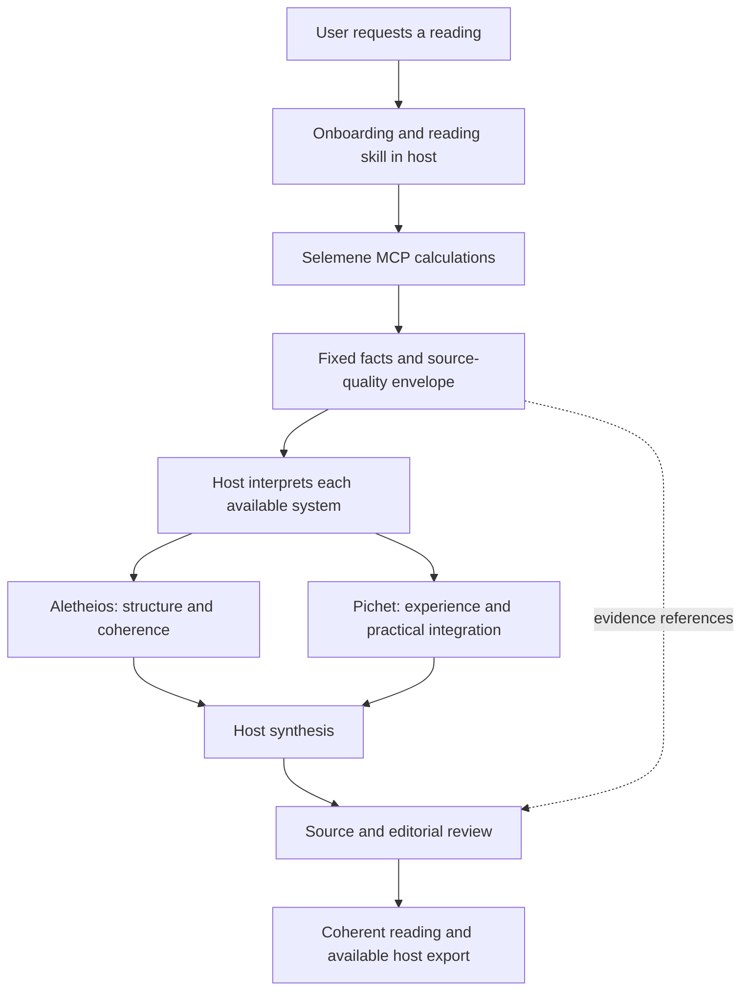

# Witness agents in the Selemene plugin

Date: 2026-10-08. Status: architecture recommendation; no plugin release, dashboard agent, OAuth client, or MCP deployment changed by this investigation.

## Recommended execution boundary

Use the plugin's reading skill to coordinate the Witness roles in the user's ChatGPT session or a native Codex session authenticated with their ChatGPT subscription. Selemene MCP supplies calculated facts. The host supplies interpretation, the two Witness perspectives, editorial review, and synthesis. Verify the host authentication/provider path: an API-key or gateway-routed Codex session has a different billing boundary. Do not import operator OmniRoute profiles or backend model assignments into the customer reading flow. The native subscription path satisfies the intended user-plan inference boundary while retaining sponsored engine infrastructure and its quotas.

The current private v0.2.4 package and portable staging copy implement Aletheios and Pichet as host writing stages with matching source-quality instructions. The completed own-profile and Hindi development rehearsals demonstrate these host perspectives; final saved-public cases remain unrun. Neither stage dispatches independent agents or establishes equivalent execution of the full legacy Witness pipeline. See [current reading skill](/Users/sheshnarayaniyer/.codex/worktrees/selemene-free-plugin/Selemene-engine/plugins/selemene-engine/skills/selemene-reading/SKILL.md:8) and [staged host flow](/Users/sheshnarayaniyer/.codex/worktrees/selemene-free-plugin/Selemene-engine/docs/plans/free-plugin/publication/public-package/selemene-engine/skills/selemene-reading/references/host-reading-flow.md:83).

The diagram shows logical stages. A parallel graph does not establish that independent agents were spawned. Use sequential host passes everywhere the plugin's skills can run. Use actual bounded native fanout only when the host exposes it and the model/provider path remains subscription authenticated, then report that execution accurately. Eligible ChatGPT Work and Codex support subagents; each agent consumes additional host tokens. [Official subagent documentation](https://learn.chatgpt.com/docs/agent-configuration/subagents).

## Reuse map

| Existing component | Plugin adaptation | Execution and status |
|---|---|---|
| Onboarding and engine preparation | Keep current onboarding; collect only the reading's required inputs and select a supported mode | Existing host skill plus `prepare_reading` |
| Deterministic Selemene engines | Reuse the current free MCP's eight discovery/preparation/calculation tools | Existing sponsored service; no Witness narration tool |
| Aletheios | Bundle generic role instructions for structural patterns, tensions, coherence, and inquiry | Already present as a host writing stage; richer role extraction proposed |
| Pichet | Bundle generic role instructions for felt experience, embodiment, and practical reflection | Already present as a host writing stage; richer role extraction proposed |
| Witness synthesis | Reuse the dependency order and reconcile both perspectives against the same facts | Current host synthesis; full legacy contract parity unproven |
| Reading mode definitions and section templates | Bundle reviewed static references beneath the existing reading skill | Proposed; mode eligibility must match the free tool and source envelope |
| Evidence map | Carry field IDs, source status, hashes and section-to-fact references in a separate evidence record | Design to adapt; persistence and validation require explicit implementation |
| Editorial rubric and leakage rules | Turn into host review instructions; port sound structural checks after repairing identified gaps | Proposed; current QA helpers are insufficient as truth validation |
| Corpus and source retrieval | Later expose bounded retrieval of approved excerpts and provenance if the deployment/access contract permits it | Proposed; current free MCP has no corpus retrieval tool |
| DOCX/PDF presentation | Use available host file/export capabilities and reviewed templates; provide Markdown when unavailable | Host dependent; current plugin does not guarantee server-renderer parity |

The current free MCP registers `list_engines`, `engine_info`, `prepare_reading`, `calculate`, `list_workflows`, `workflow_info`, `run_workflow`, and `vedic_chart`. It advertises tools only, with no registered resources, prompts, sampling, or Witness dispatch operation. [Adapter](/Users/sheshnarayaniyer/.codex/worktrees/selemene-free-plugin/Selemene-engine/workers/selemene-free-mcp/src/mcp.ts:6).

Useful source contracts are [Aletheios instructions](/Volumes/madara/2026/Projects/tryambakam-noesis/witness-agents/inference-layer/claude-adapter/aletheios-agent.md:3), [Pichet instructions](/Volumes/madara/2026/Projects/tryambakam-noesis/witness-agents/inference-layer/claude-adapter/pichet-agent.md:3), and the local [Witness dyad](/Volumes/madara/2026/Projects/tryambakam-noesis/Selemene-engine/packages/witness-pipeline/src/orchestrator/witness-dyad.ts:29). The local module identifies itself as an experimental draft. Its external `LlmCall` callbacks are execution dependencies, not portable plugin components.

The source defines a two-agent dyad; Selemene Router and Tier Gate are supporting roles rather than extra Witness agents. The sibling repository is retired for live runtime use. Curate its reader-facing contracts from `inference-layer/claude-adapter`, rather than importing its autogenerated development-pattern skill or reactivating its old services. [Dyad definition](/Volumes/madara/2026/Projects/tryambakam-noesis/witness-agents/agents/aletheios/AGENTS.md:7), [runtime status](/Volumes/madara/2026/Projects/tryambakam-noesis/witness-agents/README.md:3).

## Skill and tool packaging

Extend the existing `selemene-reading` skill with focused role, mode, source, review, and report references. Keep onboarding as a separate entry point. Add dedicated review/export skills only if users need those workflows independently. A single reading coordinator avoids overlapping triggers and keeps shared constraints in one place.

The portable plugin bundles skills, an MCP connection, and optional assets. There is no demonstrated agent-ID import or dispatcher linking this package to saved Agents dashboard objects. `agents/openai.yaml` in a skill describes presentation, dependencies, and invocation policy; it does not create a dashboard agent. [Official packaging documentation](https://developers.openai.com/plugins/build/plugins), [official skills documentation](https://developers.openai.com/plugins/build/skills).

Start with static references and the existing tools. Optional additive MCP functions should serve a concrete gap: a mode/source manifest, approved source passage retrieval, or structural validation of supplied facts and section coverage. These are proposals, not existing tools. Any check must return its tested scope and omissions. Structural success cannot certify the symbolic interpretation.

If skills are later imported from MCP through Plugin Creator's Scan Tools flow, the result is a versioned static snapshot. Runtime changes do not automatically update installed skills; redeploy/rescan/release deliberately. [Official skills import documentation](https://developers.openai.com/plugins/build/skills).

## Reading contract

1. Resolve the user's purpose, required data and output depth using onboarding. Validate time/location uncertainty before calculation.
2. Prepare and calculate the needed systems once, then preserve their returned values, source quality, errors and approximations. Reuse the same cast for Tarot/I Ching rather than silently recasting during another perspective.
3. Interpret each successful system using permitted source material. Do not invent missing facts, meanings or passages.
4. Let Aletheios and Pichet examine the same fixed factual envelope. They may suggest meaning and inquiry; they may not recalculate chart coordinates or promote an approximation to an exact result.
5. Synthesize common patterns and preserve disagreements. Review facts/source claims and prose separately. In eligible hosts, per-system interpretation and the two perspectives may be delegated after their factual inputs are available; synthesis waits for those results.
6. Present the coherent reading and practical reflection. Keep prompt text, grader internals and detailed evidence machinery outside the reader-facing report. Put necessary limitations in plain language. A separate evidence record is optional and is not an automatic backend storage permission.

Current source constraints remain binding: Gene Keys canonical coordinates and activation lines are distinct from its now-verified short public labels; full author meanings, line teachings and biological correspondences remain unavailable. Incomplete meaning data must stay incomplete. I Ching changing-line passages are unavailable even when line positions and judgment/image passages are available. A null workflow synthesis is a signal for host synthesis over successful data. Approximate Vedic chart fields retain their provenance. Full Opening + Parts I–XI legacy report equivalence requires a mode-specific acceptance check, not merely counting twelve stages.

## Dashboard Agents, Decisions and subscription usage

The actual Agents page in the selected project currently shows getting-started instructions and templates. This read-only observation does not prove an existing deployed Witness dashboard agent. Dashboard agents could use our generic Witness instructions, skills and MCP tools for an API-operated service or internal evaluation, but their default runtime bills model usage at API rates, plus applicable tools and sandbox rates. Adding that service to a plugin would not transfer its inference to the installing user's plan. [Official Agents API overview and pricing](https://developers.openai.com/api/docs/guides/agents-api/overview).

The screenshot's Decisions feature supports predicate probabilities, choices, and rubric scores through a separate API endpoint. It could help evaluate source relevance or unsupported claims in an optional API evaluation lane. It does not establish the truth of symbolic, consciousness, health, or destiny claims. The default plugin can apply an editorial rubric in the host and deterministic structural checks without adding a separate Decisions request. No Decisions subscription-sharing route was established by this investigation. [Official Decisions guide](https://developers.openai.com/api/docs/guides/decisions).

There is a future external-runtime option: Sign in with ChatGPT can authorize eligible Responses API inference against a user's plan. Current docs describe open-source/local apps and selected clients; paid or remotely hosted apps use a separate partner/interest path. It requires the user's OAuth authorization and eligible account, not the operator's API key. This capability is not implemented in the Selemene plugin. [Sign in with ChatGPT quickstart](https://developers.openai.com/siwc/quickstart), [plan usage overview](https://developers.openai.com/siwc/token-sharing-open-source).

That route currently uses Responses with streamed, non-stored requests. Preview limitations exclude the `multi_agent` field and hosted MCP/connectors. A local Codex app-server can coordinate child agents and execute MCP via supported function/custom tools, with the application managing its OAuth/session lifecycle. This does not establish compatibility for managed Agents API sessions or Decisions. [Models and inference](https://developers.openai.com/siwc/token-sharing-open-source/models-and-inference), [preview limitations](https://developers.openai.com/siwc/token-sharing-open-source/preview-limitations).

| Runtime | Inference usage boundary | Recommendation |
|---|---|---|
| Plugin skill in ChatGPT or native subscription-authenticated Codex | User's host plan, model access and limits | Default; verify authentication/provider path |
| Native host subagents where available, using the same subscription path | User's host plan; more model work/tokens | Optional bounded execution |
| Existing Witness server inference or dashboard Agents API using operator credentials | Operator API/provider billing | Separate service/evaluation lane |
| Eligible external Responses flow using user-authorized Sign in with ChatGPT | User's plan, subject to approval, scope and preview restrictions | Future option; unimplemented |

Sponsored MCP hosting and engine usage remain our infrastructure cost under the existing quota contract. User-plan inference does not imply unlimited free computation.

## Migration hazards found in current source

- Legacy [integrated-reading system prompts](/Volumes/madara/2026/Projects/tryambakam-noesis/witness-agents/scripts/integratedreading/system-prompts.ts:114) ask the model to calculate charts/dates. Replace those instructions with supplied engine facts.
- The sibling [dyad graph](/Volumes/madara/2026/Projects/tryambakam-noesis/witness-agents/src/wiring/graphs/dyad-witness.ts:54) contains fixed relationship examples in user prompts. Parameterize context; do not ship those examples as a reader's biography.
- `/api/v1/witness/interpret` attempts hosted LLM inference before its rule fallback. Do not wrap it as a zero-inference tool. [Handler](/Users/sheshnarayaniyer/.codex/worktrees/selemene-free-plugin/Selemene-engine/crates/noesis-api/src/handlers/witness.rs:233).
- Rubric token/vocabulary heuristics are not verified field grounding. Final-verification checks can miss actual rubric failure fields, and chain audit can accept empty successful engine records. Repair these contracts before exposing any validation API. [Rubric](/Users/sheshnarayaniyer/.codex/worktrees/selemene-free-plugin/Selemene-engine/packages/witness-pipeline/src/orchestrator/rubric.ts:83), [verification wrapper](/Users/sheshnarayaniyer/.codex/worktrees/selemene-free-plugin/Selemene-engine/packages/witness-pipeline/src/orchestrator/final-verification.ts:14), [chain audit](/Users/sheshnarayaniyer/.codex/worktrees/selemene-free-plugin/Selemene-engine/packages/witness-pipeline/src/assets/audit.ts:36).
- The current Rust assets route uses a seed-renderer stub in this checkout. It is not evidence of a full model-authored Witness report or a free equivalent of the JS orchestrator, which invokes its supplied LLM per pass. [Stub](/Users/sheshnarayaniyer/.codex/worktrees/selemene-free-plugin/Selemene-engine/crates/noesis-api/src/handlers/assets.rs:264), [JS runner](/Users/sheshnarayaniyer/.codex/worktrees/selemene-free-plugin/Selemene-engine/packages/witness-pipeline/src/orchestrator/integrated.ts:132).
- The current facts formatter needs adaptation for repaired Gene Keys `activation_spheres`; keeping fields in raw JSON while omitting them from extracted facts is insufficient grounding. [Formatter](/Users/sheshnarayaniyer/.codex/worktrees/selemene-free-plugin/Selemene-engine/packages/witness-pipeline/src/orchestrator/engine-formatter.ts:3).
- Legacy generator/model receipts must be replaced by actual host execution evidence; never carry forward a hardcoded NVIDIA model attribution. [Legacy stitcher](/Volumes/madara/2026/Projects/tryambakam-noesis/witness-agents/scripts/integratedreading/stitcher.ts:51).

## First implementation slice and acceptance

First adapt the generic Witness role/mode contracts into reading references and add an explicit host capability branch for sequential passes versus native subagents. Keep the current calculation tools and source-quality limits. Then demonstrate one representative reading with a separate evidence record before claiming full reference-mode parity. Add source retrieval and structural MCP checks only after their contracts and access are verified.

Acceptance must prove: tool facts remain unchanged across roles; unsupported/missing sources stay bounded; output contains coherent meaning without leaked machinery; mode coverage matches its real dependencies; the intended customer host runs the flow; and observed inference/usage remains in the intended host or authorized user-plan route. A role-labelled single-model pass is not independent-agent or independent-review proof.

This design investigation does not close the existing public publication criteria. Installed private plugin, staging package, submitted release, approved release and public directory availability remain separate states in the publication ledger.

## Current publication evidence update

The calculation repairs are merged in [PR1494](https://github.com/Sheshiyer/Selemene-engine/pull/1494), source89da83fc and merge4cadb617. Corrected TS/Rust services pass focused local and installed checks; a fresh Hindi host reading completes with the corrected chart facts and both perspectives. Durable source integration, actual running deployments, private host behavior and public publication remain separately recorded in [PUBLICATION-STATUS.md](/Users/sheshnarayaniyer/.codex/worktrees/selemene-free-plugin/Selemene-engine/docs/plans/free-plugin/publication/PUBLICATION-STATUS.md). This does not implement independent dashboard-agent dispatch or the full original report pipeline.
